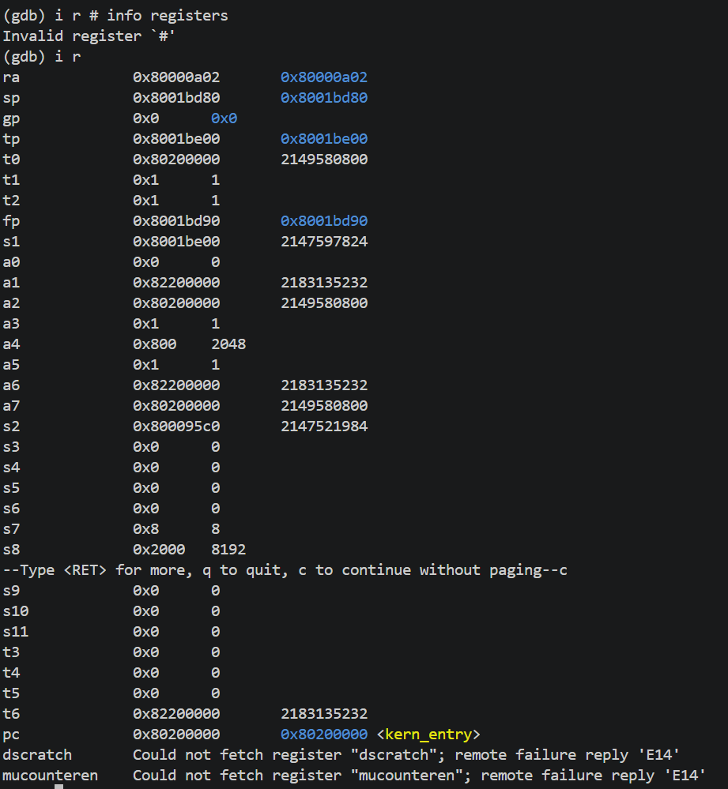
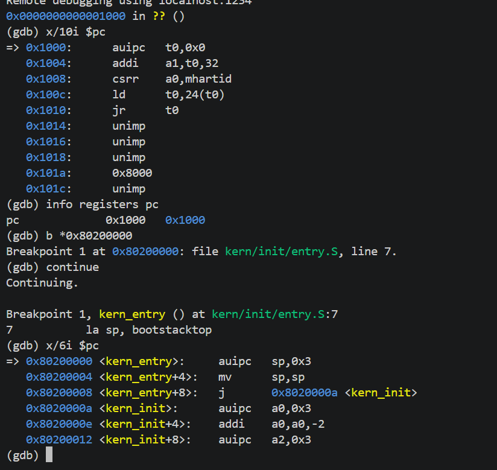
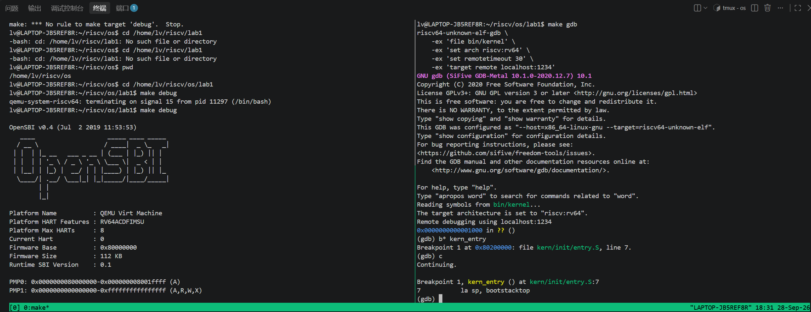
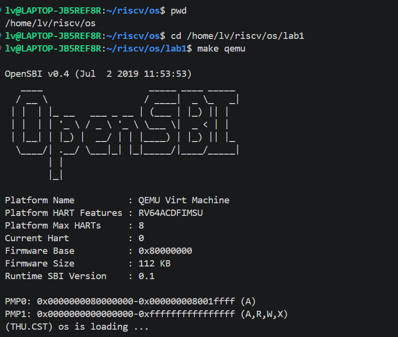
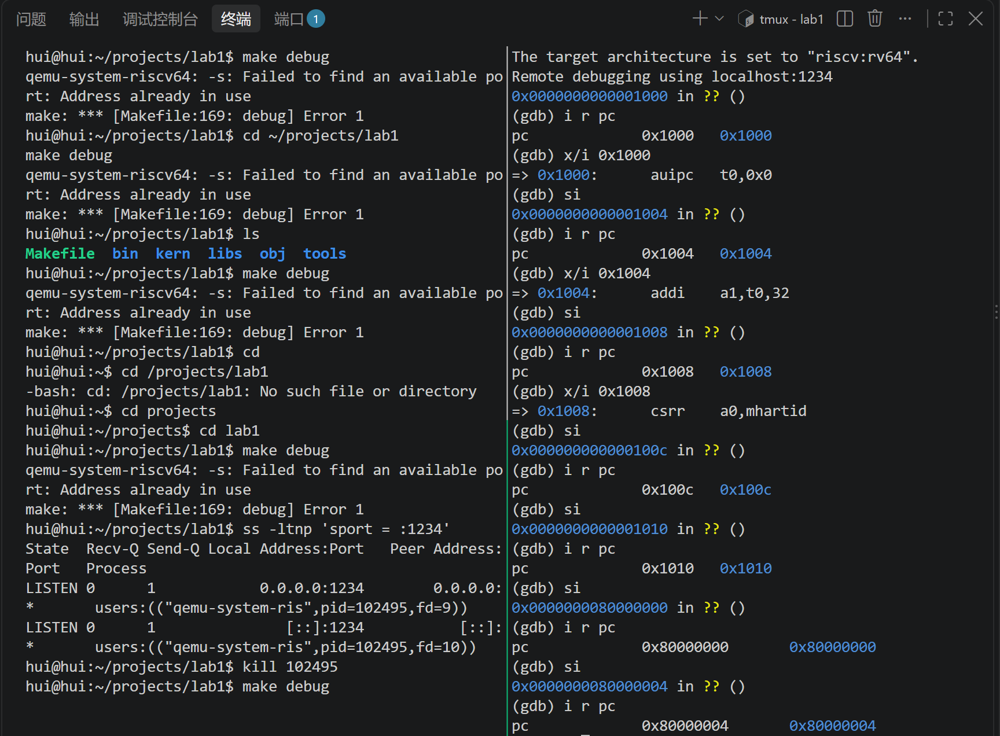

# 操作系统实验报告

## 实验基本信息

| 项目 | 内容 |
|------|------|
| **实验名称** | Lab 1: 系统启动（Boot） |
| **小组成员** | 2411764-强徽东、2411763-颜晓阳、2413287-吕驿东 |
| **完成日期** | 2026-09-28 |

### 小组分工

本实验由强徽东、颜晓阳、吕驿东三人协同完成，练习 1（内核启动流程分析）与练习 2（GDB 验证启动流程）均由三人共同协作完成。

---

## 一、实验目的

本实验旨在理解最小可执行内核的构建与启动过程，具体目标如下：

1. **理解内核启动流程**：掌握 QEMU 模拟的 RISC-V 系统从加电复位，经 MROM、OpenSBI，到执行内核入口 `kern_entry` 的过程，理解复位地址 `0x1000`、固件起始地址 `0x80000000` 和内核起始地址 `0x80200000` 的作用。
2. **理解内核初始运行环境的建立**：掌握 `la sp, bootstacktop` 设置内核栈指针、`tail kern_init` 跳转至 C 初始化函数的原理，理解栈和 BSS 段初始化的必要性。
3. **掌握内核的构建与内存布局**：理解 ELF 文件与原始二进制镜像的区别，了解链接脚本如何组织各段、确定地址并指定入口；掌握使用 Makefile 自动完成交叉编译、链接和镜像生成的方法。
4. **理解内核输出功能的分层实现**：了解如何利用 OpenSBI 提供的底层服务，逐步构建字符输出和格式化输出接口，理解内核输出模块与底层接口之间的关系。
5. **掌握内核启动的调试方法**：学会使用 QEMU 与 GDB，通过断点、指令单步、寄存器和内存检查，跟踪并验证从复位代码到内核入口的执行过程。
---

## 二、实验环境

| 成员 | AI 编程工具 | 底层模型 | 备注 |
|------|------------|---------|------|
| 2411764-强徽东 | Codex| GPT-6.1 sol | VScode+WSL2 |
| 2411763-颜晓阳 | Codex| deepseek v4 pro |WSL2+Ubuntu |
| 2413287-吕驿东 | Claude Code（终端 Agent） | deepseek v4-pro | 运行于 WSL2 + Ubuntu 环境 |

**其他工具链环境：**

- 模拟器：QEMU 4.1.1（`qemu-system-riscv64`）
- 交叉编译工具链：riscv64-unknown-elf-gcc / gdb 10.1.0（SiFive）
- 调试方式：QEMU gdb stub（`-s -S`）+ GDB 远程调试（`target remote localhost:1234`）

---

## 三、实验整体逻辑分析

### 2.1 本章节的逻辑主线

我认为本章节围绕“如何让自己编写的内核在模拟计算机上运行”展开，逐步解决内核的构建、启动、初始化和输出问题。

首先，明确运行环境和启动过程。实验使用 QEMU 模拟 RISC-V 计算机，需要了解 CPU 复位后从哪里执行、固件承担哪些任务，以及固件如何将控制权交给内核。

其次，确定内核的内存布局与入口。通过链接脚本 tools/kernel.ld，安排代码段、只读数据段、数据段和 BSS 段的位置，将内核起始地址设为 0x80200000，并指定入口符号 kern_entry。这使编译出的代码能够与启动时的加载地址相匹配。

随后，建立执行 C 代码所需的基本环境。内核最先执行 kern/init/entry.S，设置栈指针，再跳转到 C 函数 kern_init()。该函数清零 BSS 段，保证相关全局变量具有正确的初始值。

接着，提供最基本的输出能力。内核通过自身的格式化输出代码和 OpenSBI 提供的服务打印启动信息，用可观察的结果确认内核已经运行。

最后，使用 Makefile 自动完成编译、链接和镜像生成，并通过 QEMU、GDB 验证整个启动过程。

本实验实际执行的主线可以表示为：

```
CPU 复位，从 0x1000 的 MROM 执行
    → 跳转到 0x80000000 的 OpenSBI
    → OpenSBI 完成初始化并将控制权交给内核
    → 执行 0x80200000 的 kern_entry
    → 设置内核栈
    → 进入 kern_init()
    → 清零 BSS，打印启动信息
    → 进入无限循环
```

### 2.2 功能的逐步实现

本章实验按照"先定位置、再建环境、最后做输出"的顺序逐步实现：

1. **首先，通过链接脚本 `kernel.ld` 确定内核的内存布局。** 为什么首先做这个？因为只有先确定内核被加载到 `0x80200000`、各段（text/rodata/data/bss）如何排布，后续的入口地址、栈的位置、`edata`/`end` 等符号才有意义。它是整个启动过程的"地图"。

2. **接着，编写内核入口 `entry.S`。** 为什么接着做这个？因为链接脚本只是静态布局，内核真正"活起来"需要一段汇编代码完成两件 C 语言自身做不到的事：设置栈指针 `sp`（`la sp, bootstacktop`），以及跳转到 C 函数（`tail kern_init`）。栈是 C 函数调用的前提。

3. **然后，实现第一个 C 函数 `kern_init`。** 有了栈和入口，就可以进入 C 语言世界。`kern_init` 完成两件基础工作：把 BSS 段清零（保证未初始化全局变量为 0），以及打印一条启动信息。

4. **最后，打通输出链路（SBI 封装 + cprintf）。** 内核要打印信息，不能直接操作硬件，而是通过 `ecall` 调用更底层的 OpenSBI（M 模式）提供的 `console_putchar` 服务。为此实现了 `sbi_call`、`cons_putc`、`cprintf` 这一条从"格式化字符串"到"屏幕字符"的完整调用链。

这个顺序的合理性在于：**每一层都建立在前一层的基础之上**——先有布局（链接脚本）→ 才能进入入口（entry.S）→ 才能运行 C（init.c）→ 才能输出（SBI + printf）。

---

## 四、实验内容与实现

### 练习 1：阅读 `kern/init/entry.S`，理解内核入口

**负责人：** 强徽东、颜晓阳、吕驿东（三人协同）

#### 模块功能描述

**涉及的核心代码：** [kern/init/entry.S](kern/init/entry.S)

```asm
    .section .text,"ax",%progbits
    .globl kern_entry
kern_entry:
    la sp, bootstacktop        # 设置内核栈指针
    tail kern_init             # 跳转到第一个 C 函数

.section .data
    .align PGSHIFT
    .global bootstack
bootstack:
    .space KSTACKSIZE          # 预留 8KB 内核启动栈
    .global bootstacktop
bootstacktop:
```

**功能说明：**

`kern_entry` 是内核的入口（链接脚本中 `ENTRY(kern_entry)` 指定），是 OpenSBI 移交控制权后执行的第一段代码，职责是把"裸机状态"切换成"C 语言能运行的状态"。两条指令分别解决两个问题：

- `la sp, bootstacktop`：把栈指针 `sp` 指向 8KB 内核栈的**顶端**（高地址）。栈向下增长，所以 `sp` 必须初始化为栈顶。这是调用 C 函数的**前提**——C 函数保存返回地址、分配局部变量都要用栈。
- `tail kern_init`：跳转到 `kern_init`，且**不保存返回地址**。因为 `kern_init` 被声明为 `noreturn`（结尾是 `while(1)` 死循环），永远不会返回，所以用尾跳转（`j`）而非函数调用（`jal`），省去保存 `ra` 和建立栈帧的开销。

#### 最终提示词

以下是经过迭代优化后，最终成功完成该练习的提示词：

````markdown
阅读 kern/init/entry.S 内容代码，结合操作系统内核启动流程，
说明指令 la sp, bootstacktop 完成了什么操作，目的是什么？
tail kern_init 完成了什么操作，目的是什么？
````

#### 实现迭代过程

本模块的实现经历了 1 次迭代。

##### 第一次迭代

**最终结果：**

- ✅ 理解了 `la sp, bootstacktop` 的作用：`la` 是加载地址伪指令，把栈顶符号 `bootstacktop` 的地址写入 `sp`；`bootstacktop` 由 `.space KSTACKSIZE`（2 页 × 4KB = 8KB）预留，指向这段空间的最高地址。
- ✅ 理解了 `tail kern_init` 的作用：`tail` 是"跳转但不保存返回地址"的伪指令，等价于 `jal x0, kern_init`；因 `kern_init` 为 `noreturn`，无需保存返回地址。
- ✅ 通过 GDB 反汇编验证：`la sp, bootstacktop` 展开为 `auipc sp,0x3` + `mv sp,sp`，`tail kern_init` 压缩为 2 字节的 `j` 指令。

**关键改进点总结：**

1. 结合链接脚本 [tools/kernel.ld](tools/kernel.ld) 确认了 `kern_entry` 位于 `0x80200000`（`BASE_ADDRESS`），`bootstack` 位于 `.data` 段、对齐到 4KB，进行页对齐，方便后续的内存管理。
2. 结合头文件 [kern/mm/memlayout.h](kern/mm/memlayout.h) 与 [kern/mm/mmu.h](kern/mm/mmu.h) 确认了 `KSTACKSIZE = 2 × PGSIZE = 8KB`。

---

### 练习 2：使用 GDB 验证启动流程

**负责人：** 强徽东、颜晓阳、吕驿东（三人协同）

#### 模块功能描述

**目标：** 使用 GDB 跟踪 QEMU 模拟的 RISC-V 从加电开始，直到执行内核第一条指令（跳转到 `0x80200000`）的整个过程，回答"加电后最初执行的几条指令位于什么地址、完成了什么功能"。

**调试方法：**

- 终端 1：`make debug` 启动 QEMU，`-s -S` 参数使其监听 1234 端口并暂停等待 GDB。
- 终端 2：`make gdb` 启动 GDB 并连接（`target remote localhost:1234`）。
- 用 `x/i $pc` 反汇编复位地址处的指令，用 `b *0x80200000` 设断点，`continue` 后停在内核入口。

#### 最终提示词

以下是经过迭代优化后，最终成功完成该练习的提示词：

````markdown
使用 GDB 跟踪 QEMU 模拟的 RISC-V 从加电开始，直到执行内核第一条指令
（跳转到 0x80200000）的整个过程。教我完成这个过程。
````
````markdown
阅读下面的代码
0x1000:      auipc   t0,0x0
0x1004:      addi    a1,t0,32
0x1008:      csrr    a0,mhartid
0x100c:      ld      t0,24(t0)
0x1010:      jr      t0
这是RISC-V 硬件加电后最初执行的几条指令，告诉我他们主要完成了哪些功能。
````
#### 实现迭代过程

本模块的实现经历了 3 次迭代（主要围绕 GDB 连接环境问题）。

##### 第一次迭代 —— GDB 连接失败（读不到寄存器）

**遇到的问题：**

- 问题 1：`make gdb` 连接后出现 `Remote replied unexpectedly to 'vMustReplyEmpty': timeout`，随后 `x/10i $pc` 报 `No registers`，无法读取寄存器。
  - 原因分析：GDB 10.1 在连接时会发送 `vMustReplyEmpty` 探测包，而 QEMU 4.1.1 的 gdb stub 不支持该包，默认 2 秒超时过短导致握手失败。

**问题解决策略：**

- 针对问题 1：在 Makefile 的 `gdb` 目标中增加 `-ex 'set remotetimeout 30'`，拉长 GDB 等待目标响应的超时时间，连接即稳定。

##### 第二次迭代 —— 端口占用 / GDB 卡死

**遇到的问题：**

- 问题 2：`make debug` 报 `Failed to find an available port: Address already in use`（端口 1234 被残留的 QEMU 进程占用）。
- 问题 3：GDB 连接失败后，QEMU 的 gdb stub 残留"半损坏"状态，导致下次连接卡在 `Remote debugging using localhost:1234` 超过 2 分钟也不出 `(gdb)` 提示符。

**问题解决策略：**

- 针对问题 2：用 `pkill -f qemu-system-riscv64` 清理残留进程，释放 1234 端口。
- 针对问题 3：总结出操作纪律——连接失败后必须**先重启 QEMU 再重连**，不能直接重连同一个 QEMU 实例。

##### 第三次迭代 —— 观察点不触发

**遇到的问题：**

- 问题 4：题目建议用 `watch *0x80200000` 观察"内核加载瞬间"，但观察点始终不触发，程序一直跑。

**问题解决策略：**

- 针对问题 4：查明原因——本实验 Makefile 使用 `-device loader,file=bin/ucore.img,addr=0x80200000`，内核在 **CPU 复位之前**就由 QEMU 的 loader 设备加载好了，写入发生在连接 GDB 之前，因此 `watch` 永远等不到。改用 `b *0x80200000` 断点直接验证内核入口，同样达到目的且更简单。

**最终结果：**
硬件加电后最初执行的几条指令地址为0x1000,0x1004,0x1008,0x100c,0x1010,然后就跳转到0x80000000执行OpenSBI。

这五条指令位于本实验 QEMU 模拟平台的 **MROM 复位入口**，主要完成两件事：**准备 OpenSBI 的启动参数，并跳转到 OpenSBI 执行。**

| 地址 | 指令 | 主要功能 |
|---|---|---|
| `0x1000` | `auipc t0,0x0` | 将当前 PC 加上立即数形成地址。这里立即数为零，因此执行后 `t0 = 0x1000`，作为后续寻址的基准。 |
| `0x1004` | `addi a1,t0,32` | 设置 `a1 = 0x1020`。在本实验的 QEMU 启动布局中，这是设备树 DTB 的地址，用于向 OpenSBI 提供硬件描述信息。 |
| `0x1008` | `csrr a0,mhartid` | 读取当前硬件线程的编号 `mhartid`，放入参数寄存器 `a0`，告诉 OpenSBI 当前由哪个 hart 执行启动。 |
| `0x100c` | `ld t0,24(t0)` | 从 `0x1000 + 24 = 0x1018` 读取一个 64 位值，写入 `t0`。这里保存的是下一阶段的入口地址，本实验为 OpenSBI 的起始地址 `0x80000000`。 |
| `0x1010` | `jr t0` | 跳转到 `t0` 指定的地址，将控制权交给 OpenSBI。它不保存返回地址。 |

注意，`ld` 是**读取地址处保存的内容**，所以执行后 `t0` 的值不是 `0x1018`，而是该位置存放的入口地址。


加电复位后，CPU 从 `0x1000` 开始执行 MROM 中的引导代码。该代码通过 PC 相对寻址获得启动数据的位置，将设备树地址和当前 hart 编号分别放入 `a1`、`a0`，随后读取 OpenSBI 的入口地址，并通过间接跳转将控制权交给 OpenSBI，为后续固件初始化和内核启动做好准备。
此外成功在 `0x80200000` 断点命中，验证内核入口为 `kern_entry`。反汇编结果与 `entry.S` 源码一致

---

## 五、测试与验证

### 5.1 复位地址 0x1000 的观察结果

用 GDB 连接后，`info registers pc` 显示 PC = `0x1000`，`x/10i $pc` 反汇编出 OpenSBI 固件入口的前几条指令：

```
(gdb) x/10i $pc
=> 0x1000:   auipc t0,0x0       # t0 = 0x1000
   0x1004:   addi  a1,t0,32     # a1 = 0x1020
   0x1008:   csrr  a0,mhartid   # 读当前硬件线程号
   0x100c:   ld    t0,24(t0)    # t0 = 内存[0x1018] 存的跳转地址
   0x1010:   jr    t0           # 跳转到下一阶段固件入口
```


### 5.2 断点停在内核入口 0x80200000

```
(gdb) b *0x80200000
Breakpoint 1 at 0x80200000: file kern/init/entry.S, line 7.

(gdb) continue
Breakpoint 1, kern_entry () at kern/init/entry.S:7
7           la sp, bootstacktop

(gdb) x/6i $pc
=> 0x80200000 <kern_entry>:   auipc sp,0x3
   0x80200004 <kern_entry+4>: mv  sp,sp
   0x80200008 <kern_entry+8>: j   0x8020000a <kern_init>
```

反汇编结果验证了 `la sp, bootstacktop` 展开为 `auipc sp,0x3` + `mv sp,sp`，`tail kern_init` 压缩为 2 字节的 `j` 指令，与练习 1 的分析完全一致。

### 5.3 测试截图

**图 1：gdb 执行 `info registers`（简写 `i r`）查看各个寄存器的值**



**图 2：gdb 执行 `x/10i $pc` 观察复位地址 0x1000 处 OpenSBI 入口指令的输出**



**图 3：tmux 分屏——一边 QEMU、一边 gdb 远程调试的完整终端界面**



**图 4：make qemu 启动 QEMU，OpenSBI 打印信息并输出 "(THU.CST) os is loading ..."**



**图 5：单步调试进一步确定这个过程**

---

## 六、实验总结与收获

### 对操作系统的理解

#### 1. 本实验重要知识点与对应 OS 原理

| 本实验知识点 | 对应 OS 原理 | 含义、关系与差异 |
|------|------|------|
| **内核启动流程**（MROM → OpenSBI → `kern_entry` → `kern_init`） | 系统引导（Bootstrap / bootloader） | 两者都描述机器如何从复位状态进入操作系统。OS 原理讨论的是引导的**通用过程**，本实验展示其在 RISC-V + OpenSBI 上的**具体实现**。本实验由 QEMU 的 `-device loader` 将内核镜像放到 `0x80200000`，OpenSBI 完成初始化后将控制权交给内核。 |
| **栈的建立**（`la sp, bootstacktop`） | 函数调用约定、栈帧（stack frame）、执行上下文 | 栈用于保存局部变量、寄存器和函数调用信息。本实验通过 `.space KSTACKSIZE` **静态预留栈空间**，再设置 `sp`，为执行 C 函数建立基本环境。它为后续上下文管理提供基础，但尚未涉及多个进程或线程的栈及上下文切换。 |
| **链接脚本与内存布局**（`kernel.ld`） | 程序装载、地址空间布局 | 两者都涉及程序的代码和数据如何组织。链接脚本确定的是**链接阶段的静态布局**，包括各 section 的地址和 `etext`、`edata`、`end` 等符号；程序装载则是在**运行准备阶段**将代码和数据放入内存。本实验由 QEMU 完成加载，尚未实现进程独立地址空间。 |
| **特权级与 `ecall`**（SBI 调用） | 特权级（M/S/U）、受控服务接口、系统调用 | 二者都体现“较低特权级通过规定接口请求较高特权级服务”。`ecall` 是触发环境调用异常的**硬件指令**；本实验的 SBI 调用是 S 模式内核请求 M 模式固件服务，而用户程序的系统调用通常是 U 模式请求 S 模式内核服务。两者使用相似机制，但服务对象和所处层次不同。 |
| **尾跳转**（`tail kern_init`） | 函数调用与返回、控制流转移 | 普通调用需要保存返回地址，尾跳转则不产生新的返回地址。本实验在汇编入口中显式使用 `tail` 将控制权交给不返回的 `kern_init()`，体现了**无需返回的控制权交接**。`tail` 是汇编伪指令，不能简单等同于编译器自动进行的尾调用优化。 |
| **BSS 段清零**（`memset(edata, 0, end-edata)`） | 运行时初始化、静态存储期变量的初始状态 | 未显式初始化的全局变量和静态变量需要具有规定的零初始化状态。BSS 在文件中通常**不保存与其内存大小相等的零字节内容**，但运行时需要占用内存。本实验由 `kern_init()` 主动清零，承担部分运行时初始化工作；这与动态内存分配、页面管理属于不同任务。 |
| **格式化输出与 SBI 服务分层**（`cprintf()`、控制台模块、SBI 接口） | I/O 抽象、设备管理、分层设计 | 上层格式化输出负责将格式串和参数转换为字符，底层接口负责将字符输出到设备，体现了**输出逻辑与底层实现的分离**。本实验通过 OpenSBI 服务提供基本字符输出，尚未实现完整的设备驱动管理、缓冲、异步 I/O 和设备调度。 |
| **ELF 文件与原始二进制镜像**（`bin/kernel`、`bin/ucore.img`） | 可执行文件格式与程序装载 | ELF 包含描述代码、数据及布局的元信息，本实验还保留其符号和调试信息供 GDB 使用；原始二进制镜像主要保存需要加载的内容，需要外部指定加载位置。本实验通过 `objcopy` 完成转换，再按固定地址加载，尚未实现内核中的通用 ELF 装载器。 |

#### 2. OS 原理中重要、但本实验未对应的知识点

1. **进程与线程管理**：本实验内核完成初始化后进入 `while (1)` 无限循环，尚未实现进程控制块、进程与线程的创建和退出，以及上下文切换等机制。

2. **虚拟内存与页表**：本实验内核在固定物理地址处启动，尚未实现页表管理、进程地址空间、缺页处理、按需分页和页面置换等机制。

3. **中断与异常处理**：本实验尚未建立内核自身完整的陷入入口、现场保存、异常分发和现场恢复机制。SBI 的 `ecall` 会触发由固件处理的异常，但这不代表实验内核已经实现完整的中断与异常框架。

4. **系统调用**：本实验使用 SBI 调用请求固件服务（S→M），尚未实现用户态程序向内核发起的系统调用（U→S），也没有对应的参数检查和系统调用分发机制。

5. **文件系统**：本实验尚未实现文件与目录、磁盘块分配、文件读写和持久化存储等抽象。`ucore.img` 是内核镜像，其存在不代表内核已经具有文件系统。

6. **进程调度**：本实验没有就绪队列、时间片和调度算法，尚未涉及多个可运行任务之间的 CPU 分配。末尾的无限循环不属于调度机制。

7. **物理内存管理与动态分配**：本实验使用链接脚本安排静态内存布局，并预留启动栈，尚未实现物理页分配、内存回收或动态分配器。BSS 清零与栈空间预留都是初始化工作，不能替代完整的内存管理。

8. **并发、同步与进程间通信**：本实验尚未涉及多个执行流的协作，没有实现锁、信号量、条件变量、消息传递等机制，也未处理竞争条件与死锁问题。

9. **资源保护与隔离**：虽然实验涉及 RISC-V 特权级和 SBI 接口，但尚未实现不同进程之间的内存隔离、资源访问权限、用户身份管理和资源配额等保护机制。

#### 3. 对该实验核心模块的理解

1. **构建模块**（`Makefile` 和 `tools/function.mk`）：组织源码之间的依赖关系，调用 RISC-V 交叉编译工具链，将 C 和汇编源码编译为目标文件，再链接生成 ELF 格式的 `bin/kernel`，供 GDB 加载符号和调试信息；随后通过 `objcopy` 转换为二进制镜像 `bin/ucore.img`。Makefile 将构建步骤自动化，并根据文件更新情况决定需要重新构建的部分。

2. **内存布局模块**（`tools/kernel.ld`）：规定各个 section 的组合方式及其地址，通过 `BASE_ADDRESS = 0x80200000` 确定内核的链接起始地址，通过 `ENTRY(kern_entry)` 指定 ELF 入口符号，并提供 `edata`、`end` 等符号供初始化代码使用。`ALIGN(0x1000)` 用于将地址对齐到 4096 字节边界。链接脚本负责静态布局，实际加载和启动由 QEMU 与固件配合完成。

3. **汇编入口模块**（`kern/init/entry.S` 中的 `kern_entry`）：连接固件启动过程与 C 语言内核初始化。`la sp, bootstacktop` 将预留的内核栈顶地址写入 `sp`，为后续函数调用建立栈环境；`tail kern_init` 通过尾跳转将控制权交给 `kern_init()`，不产生新的返回地址。栈空间通过 `.space KSTACKSIZE` 静态预留，不属于运行时动态分配。

4. **内核初始化模块**（`kern/init/init.c` 中的 `kern_init()`）：通过 `memset(edata, 0, end - edata)` 清零 BSS 区域，保证相关变量具有正确的初始状态；随后调用 `cprintf()` 打印启动信息，提供内核已经运行的可观察结果；最后进入 `while (1)` 无限循环，使执行流程停留在内核中。

5. **输出模块**（`cprintf()`、控制台模块和 SBI 封装）：`cprintf()` 将格式串和参数转换为字符，控制台模块衔接字符输出，SBI 封装则使内核能够使用 OpenSBI 提供的底层服务。这一结构体现了分层设计，将格式化逻辑与底层输出接口分离，并通过实验自身提供的库代码实现基本输出功能。

6. **运行与验证模块**（QEMU 和 GDB）：QEMU 提供模拟的 RISC-V CPU、内存和设备，使内核能够运行；GDB 通过 QEMU 的调试接口检查 PC、寄存器、内存和指令，并支持断点与单步执行，用于验证启动流程及初始化行为。二者属于实验开发与调试工具，不属于内核自身实现的功能。
### AI 协作开发的经验

1. **AI 擅长解释"为什么"，但不一定能"手把手"替代调试。** 在练习 1 中，AI 对 `la sp, bootstacktop` 和 `tail kern_init` 的解释清晰准确；但在练习 2 的调试中，遇到的是 QEMU 4.1.1 与 GDB 10.1 的**版本兼容性问题**（`vMustReplyEmpty` 超时），这类具体环境问题需要 AI 先复现、再定位，最终通过 `set remotetimeout 30` 解决。经验是：**环境类问题要先把报错信息完整交给 AI，而不是让它凭空猜。**

2. **调试时要注意工具链的版本匹配。** 本次实验最大的坑是 QEMU 4.1.1 的 gdb stub 与较新 GDB 的协议不兼容，导致连接握手失败、`watch` 观察点不触发等连锁问题。AI 帮我定位了根因（`vMustReplyEmpty`、loader 预加载），并总结出"失败后先重启 QEMU 再重连"的操作纪律。

3. **交叉编译环境下，路径和工具名容易踩坑。** 从 Windows 拷贝文件到 WSL 时，Windows 的 `C:\...` 要转换为 `/mnt/c/...`；调试要用 `riscv64-unknown-elf-gdb` 而不是普通的 `gdb`。AI 帮我理清了这些跨平台细节。

---
