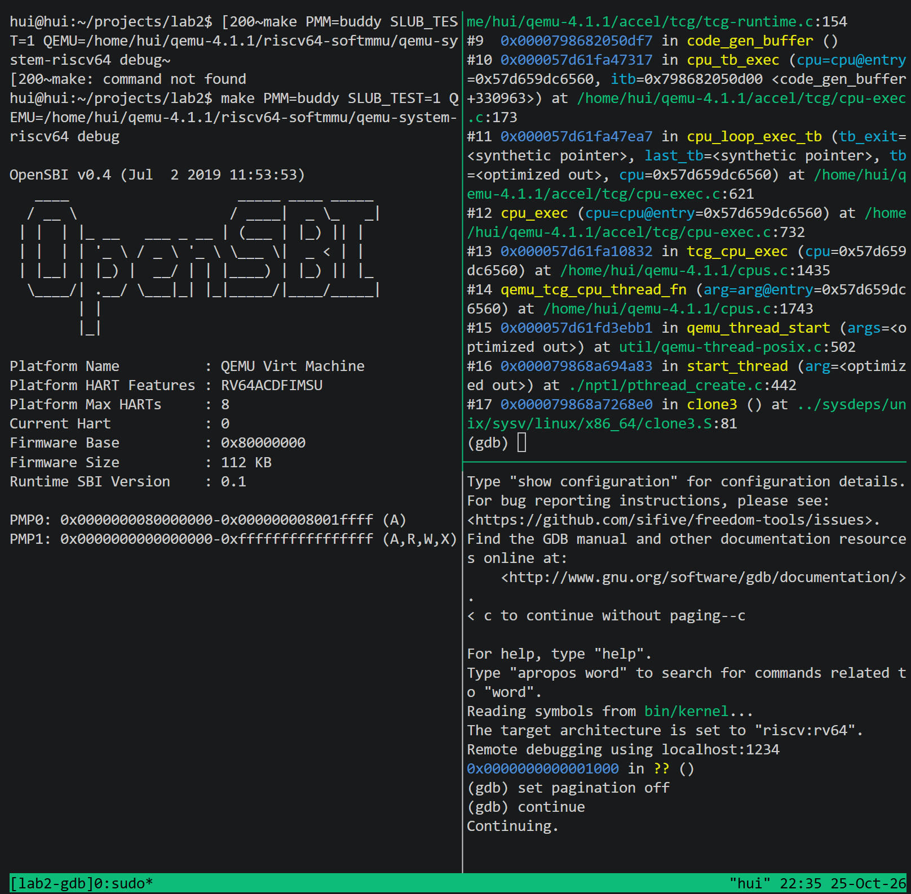
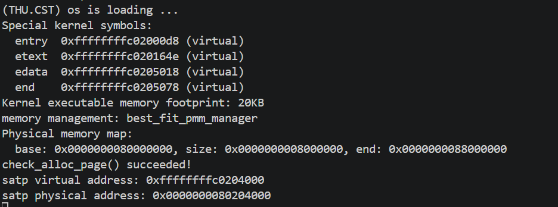
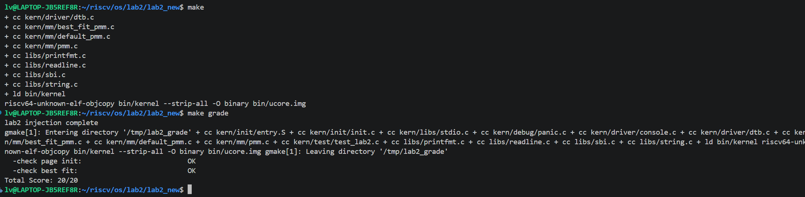
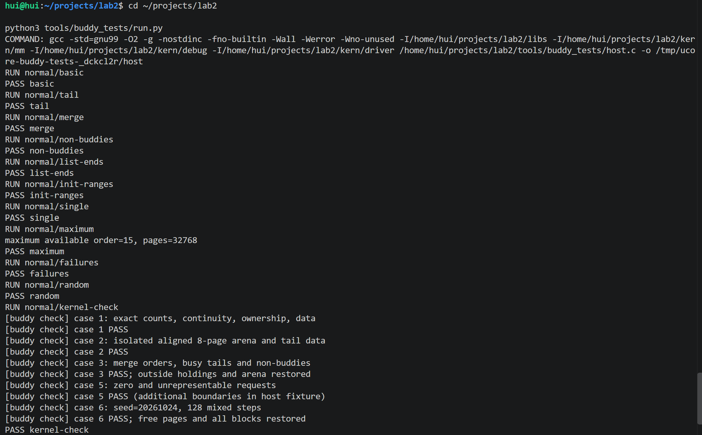
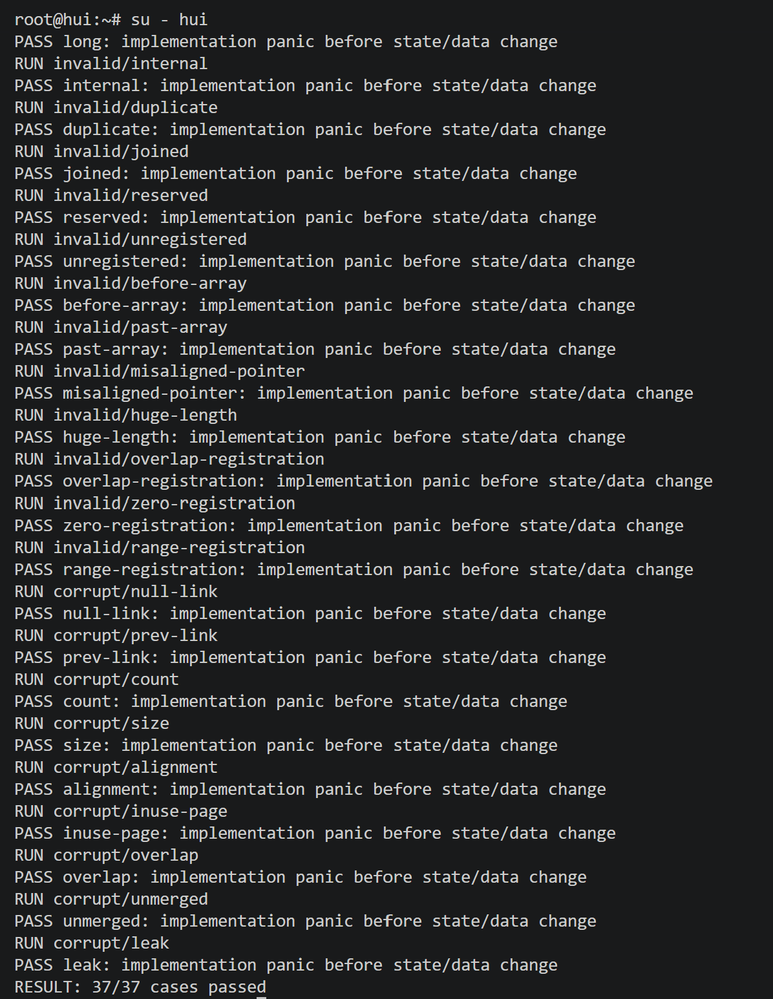
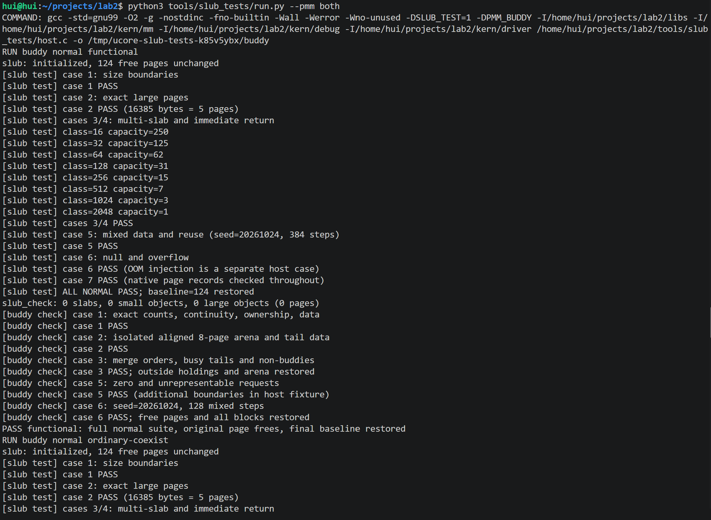
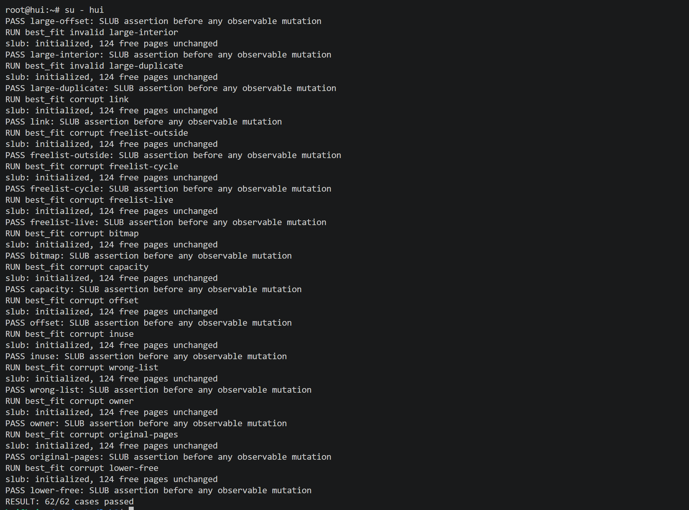

# 操作系统实验报告

## 一、实验基本信息

| 项目 | 内容 |
|---|---|
| **实验名称** | Lab 2：物理内存和页表 |
| **小组成员** | 2411764-强徽东、2411763-颜晓阳、2413287-吕驿东 |
| **完成日期** | 2026-10-25 |
| **报告范围** | 物理内存初始化、First-Fit 分析、Best-Fit、Buddy 精确页数分配、简化 SLUB、GDB 页表查询调试及相关验证 |

### 小组分工

| 成员 | 负责的练习或模块 |
|---|---|
| 2413287-吕驿东 | 物理内存初始化、First-Fit 思考题、Best-Fit 实现 |
| 2411764-强徽东 | 思考题讨论、SLUB 实现和测试、GDB 调试 |
| 2411763-颜晓阳 | Buddy 实现和测试、GDB 调试、思考题讨论 |


---

## 二、实验环境

### 2.1 开发与运行环境

| 项目 | 实验环境或配置 |
|---|---|
| 主机与开发方式 | Windows 主机，VS Code / Codex，WSL2 Ubuntu 22.04 |
| WSL 内核 | 6.6.87.2-microsoft-standard-WSL2|
| 交叉编译器 | riscv64-unknown-elf-gcc，SiFive GCC-Metal 10.2.0 |
| 主机测试编译器 | GCC 11.4.0 |
| 模拟器 | QEMU 4.1.1，RISC-V virt 平台 |
| 启动固件 | OpenSBI 0.4（启动输出） |
| Python / 构建工具 | Python 3.10.12 / GNU Make 4.3 |
| 默认模拟 RAM | 128 MiB，物理区间 `[0x80000000, 0x88000000)` |
| 页大小 | `PGSIZE = 4096` 字节，`PGSHIFT = 12` |
| 页分配器选择 | `PMM=buddy` 或 `PMM=best_fit`，当前默认 Buddy |
| SLUB 自检开关 | `SLUB_TEST=1` 启用，`SLUB_TEST=0` 不执行完整对象功能测试 |

### 2.2 AI 编程工具记录

| 成员 | AI 编程工具 | 底层模型 | 备注 |
|---|---|---|---|
| 2411764-强徽东 | Codex | GPT-6.1 sol | VS Code + WSL2 |
| 2411763-颜晓阳 | Codex | deepseek v4 pro | WSL2 + Ubuntu |
| 2413287-吕驿东 | Claude Code（终端 Agent） | deepseek v4-pro | 运行于 WSL2 + Ubuntu 环境 |

---

## 三、实验整体逻辑分析

### 3.1 本章节的逻辑主线

本章围绕“如何发现、描述和分配物理内存”展开。在最小可执行内核的基础上，先通过启动阶段传入的设备树获取内存范围，再建立每个物理页对应的 `Page` 描述符，排除已有占用，最后把空闲页交给具体分配算法。完成页粒度管理后，再通过 SLUB 将页面细分为不同大小的内核对象。

当前执行链为：

```text
kern_entry：保存 hartid / DTB，建立启动页表并设置 satp
    ↓
kern_init：清 BSS → dtb_init → 控制台与内核信息
    ↓
pmm_init
    ├─ init_pmm_manager → 选择管理器并初始化其内部状态
    ├─ page_init → 建立 Page 数组 → init_memmap 注册空闲页
    ├─ check_alloc_page → 当前页分配器自检
    └─ 保存并打印启动页表地址
    ↓
slub_init
    ↓ SLUB_TEST=1 时
slub_check
    ↓
内核进入 while(1)
```

`entry.S` 在进入 `kern_init()` 前已经启用 Sv39 启动映射，页分配器在内核虚拟地址环境中管理物理页。CPU 地址翻译负责将虚拟地址映射到物理地址，物理页分配器负责记录和分配空闲页。

### 3.2 功能的逐步实现

1. **物理内存初始化**：读取 DTB，建立描述符并登记完整空闲页，是全部分配器的基础。
2. **First-Fit**：理解按地址组织空闲块、寻找第一个够大块、切分及相邻合并的流程。
3. **Best-Fit**：在相同链表组织方式下选择最小的合格块。它改变选块策略，但不保证对所有请求序列都更少碎片，也没有自动实现更快的索引。
4. **Buddy**：按物理对齐的 2 次幂块分阶管理，使用伙伴关系拆分、合并；本组在其外层增加精确连续页数语义。
5. **SLUB**：下层向页分配器请求页面，上层在 slab 中复用固定类别的对象槽位，支持任意请求字节数及大对象页分配。

### 3.3 地址、描述符和所有权

| 名称 | 含义与关系 |
|---|---|
| `end` | 链接器给出的内核镜像末端虚拟地址 |
| `pages` | `Page` 描述符数组的虚拟地址，不是可分配物理页的地址 |
| `nbase` | DRAM 起始物理页号，当前为 `0x80000` |
| `npage` | 可管理物理页号的排他上界；实际描述符数量为 `npage-nbase` |
| `page2ppn(p)` | `p - pages + nbase` |
| `page2pa(p)` | 由物理页号得到物理地址 |
| `pa2page(pa)` | 由物理地址查找描述符，使用前还要保证下界合法 |
| `va_pa_offset` | 已有内核直接映射的固定虚实地址偏移 |

模块二的 `alloc_pages(n)` 每次返回的页面必须在物理上连续；不同次申请之间不要求相邻。本组 Buddy 成功时精确占用 `n` 页，而不是让调用者永久持有取整后的全部页。SLUB 返回可访问的内核虚拟地址；对一个对象所占据的范围提供连续存储，不要求不同对象彼此相邻。

---

## 四、实验内容与实现

### 功能模块一：物理内存初始化功能

**负责人：** 2413287-吕驿东。

#### 任务一：实现物理内存探测与页描述符初始化功能

##### 模块功能描述与 SPEC

主要函数为 `static void page_init(void)`。其职责是连接 DTB 探测结果和当前页分配器，不在这里重写设备树解析算法。

| 规格字段 | 本任务约定 |
|---|---|
| Pre-Condition | 启动映射和 DTB 解析可用；当前管理器已经执行 `init()`，尚未登记初始空闲区 |
| Post-Condition | 正确设置偏移、页号上界与描述符数组；内核和管理数据保持保留；仅完整空闲页进入管理器 |
| Case 1：正常范围 | 限制管理末端、检查描述符布局、设置保留状态并登记剩余完整页面 |
| Case 2：非法或放不下 | 加法溢出、不支持的起点、无有效管理范围或描述符空间不足时，在越界写入前终止 |
| Case 3：无完整空闲页 | 不调用 `init_memmap(...,0)`；不能用不足一页的尾部冒充可分配页 |
| Requirements | 区分虚拟地址、物理地址和页号，正确使用向上/向下对齐；不释放内核、OpenSBI 和描述符占用 |

当前实现的关键步骤如下：先验证 `mem_base + mem_size` 不溢出，确认固定映射支持该起点；取实际 RAM 末端和 `PHYSICAL_MEMORY_END` 中较小者并向下按页对齐，再计算 `npage`。随后将 `pages` 放在 `end` 后的页边界，检查整个数组能否容纳，最后得到向上对齐的 `freemem`。

```c
uintptr_t managed_end = ROUNDDOWN(
    mem_end < PHYSICAL_MEMORY_END ? mem_end : PHYSICAL_MEMORY_END,
    PGSIZE);
npage = managed_end / PGSIZE;
```

内存布局为：

```text
OpenSBI | 内核镜像 | 对齐空隙 | Page数组 | 对齐空隙 | 完整空闲页 | 不足一页尾部
                   前述占用保持保留                    ↑ freemem
```

描述符数量和最终空闲区使用同一个 `managed_end`，避免只限制 `npage` 却仍把上界外页面交给管理器。SLUB 扩展了 `Page` 字段，因此数组空间继续按 `sizeof(struct Page)` 计算，不能沿用旧结构体大小。

##### 最终提示词与需求表达

需求涵盖设备树信息、保留页、描述符布局、管理上界、算术溢出和不足一页的边界处理。实现提示词如下。


```text
任务一：实现物理内存探测与页描述符初始化功能

要求实现的函数：
static void page_init(void);  // kern/mm/pmm.c

功能与接口说明：
根据设备树提供的物理内存信息建立可管理物理页的描述符布局，并把排除 OpenSBI、
内核镜像和描述符数组占用空间后的完整空闲页面交给当前 pmm_manager 管理，
为后续页面分配提供正确的初始状态。page_init() 不接收参数也不返回结果，由
pmm_init() 调用；成功返回时应正确设置 va_pa_offset、npage 和 pages，输出探测
到的物理内存范围，并完成当前物理内存管理器初始空闲区的注册。

实现约束与可用资源：
必须区分虚拟地址、物理地址、物理页号和 Page 描述符地址，正确处理可管理上界和
页面对齐，并确保内核及描述符数组不会进入空闲区；设备树信息无效时应终止初始化，
没有可用完整页面时不得调用 init_memmap()。可以使用 get_memory_base()、
get_memory_size()、panic()、cprintf()、init_memmap()、pa2page()、链接符号 end、
struct Page 及相关全局变量，并使用框架提供的内存上界、地址转换、页面对齐和
页面状态宏完成初始化。
```

</details>

##### 实现迭代过程

本模块共完成 **3 次迭代**。

| 迭代 | 问题 | 定位与处理 |
|---|---|---|
| 第一次 | `PADDR` 宏相关编译错误 | 宏体中误插的行注释及缺失续行使宏提前结束，删除错误注释后恢复编译 |
| 第二次 | `assert(PageReserved(p))` 失败 | `page_init` 提前清除待登记页的 reserved；改为保留该状态，由管理器 `init_memmap` 验证并清除 |
| 第三次 | 未限制管理上界；不足一页仍可能登记0页；写描述符前缺少完整布局校验 | 检查溢出和起点，统一使用对齐后的管理末端，提前验证数组空间，只登记正数个完整页面 |

第三次迭代重点完善边界处理：`freemem < mem_end` 不能保证 `(mem_end-freemem)/PGSIZE > 0`，差值不足一页时会产生零长度登记。因此先将管理末端向下按页对齐，再计算完整空闲页数。

最终通过默认配置下的编译、启动与 Page Init 评分。当前验证范围为实验平台支持的内存布局。

#### 扩展思考：如何获取未知硬件的可用物理内存范围

**讨论成员：** 2411764-强徽东、2411763-颜晓阳。

内核不应只假定所有物理地址都可当作 RAM，也不能通过任意地址试写来可靠识别内存，因为地址可能对应外设、保留区或不存在的空间。

当前 RISC-V virt 环境通过启动阶段的 `a1` 参数传递 DTB 地址，`dtb_init()` 从内存节点读取起点和长度；DTB 的 memory 节点本来就用于描述系统物理内存布局。[Devicetree 规范](https://devicetree-specification.readthedocs.io/en/stable/devicenodes.html)

其他平台可以由固件或引导程序提供内存地图，例如 UEFI 的 `GetMemoryMap()` 返回描述 RAM 与固件保留范围的描述符。[UEFI 内存地图接口说明](https://uefi.org/htmlspecs/ACPI_Spec_6_4_html/15_System_Address_Map_Interfaces/uefi-getmemorymap-boot-services-function.html)

获得地图后仍要区分可用区与保留区，排除内核及管理元数据占用，再按完整页登记。当前实验 DTB 解析器和固定偏移映射是简化实现，不等价于通用的多段 RAM、所有固件保留区处理。

---

### 功能模块二：物理内存分配功能

#### 任务一：理解 First-Fit 连续物理内存分配算法

**负责人：** 2413287-吕驿东。

**思考题讨论：** 2411764-强徽东、2411763-颜晓阳。

First-Fit 从按地址排序的空闲块链表中寻找第一个大小不小于需求的块。

| 核心函数 | 功能 |
|---|---|
| `default_init()` | 建立空环形链表，空闲页计数归零 |
| `default_init_memmap(base,n)` | 接收保留状态的合法区间，清理状态，仅在块头记录长度及 `PG_property`，按地址插入 |
| `default_alloc_pages(n)` | 找第一个够大的块，摘下后分出前n页，剩余部分用新的块头留在原位置 |
| `default_free_pages(base,n)` | 验证并回收页面，按地址插入，再与连续的前驱、后继合并 |

`PageProperty` 只表示空闲块头，空闲块内部页可以没有该位；`property` 在块头记录长度。相邻判断 `p + p->property == base` 成立，是因为真实 `Page` 数组顺序与物理页顺序对应。

**是否有改进空间？** 有，但需要区分正确性修复和策略优化：

1. 保证插入和合并正确，修复两个尾部插入分支缺少 `break` 的问题。
2. Next-Fit 可以减少部分负载下重复从头搜索，但最坏情况仍可能线性扫描；平衡树或大小分桶可引入更快索引。
3. Best-Fit 改变选块策略，并不保证长期碎片一定更少；Buddy 则以分阶规则简化组织方式，也仍可能因在用页分隔而缺少大块。
4. 已用页隔开两个空闲区时，单纯重复执行合并不能跨过它。要改变这种布局需等待释放，或实现带地址重映射/数据迁移的内存整理，不能把“定期合并”当作通用解决办法。
5. 对齐、大页、NUMA 及并发支持需要额外设计，不属于当前链表实现已经完成的能力。


#### 任务二：实现 Best-Fit 连续物理内存分配算法

**负责人：** 2413287-吕驿东。

##### 模块功能与 SPEC

主要接口为 `best_fit_init`、`best_fit_init_memmap`、`best_fit_alloc_pages`、`best_fit_free_pages`、`best_fit_nr_free_pages` 以及 `best_fit_pmm_manager` 注册结构。

| 接口 | 前置条件与主要后置状态 |
|---|---|
| 初始化 | 建立空链表和零计数，之后才能登记区间 |
| 登记空闲区 | 输入为合法保留页；输出为按地址组织的空闲块 |
| 分配 | n为正数；成功选择满足n页且最小的块，切分后计数减n；无合适连续块则失败 |
| 释放 | 输入为当前实现支持的合法占用区间；输出按地址插入并完成两侧相邻合并，计数加n |
| 统计 / 检查 | 返回真实空闲页数，使用规定测试，不通过修改测试掩盖错误 |

分配器沿用按地址排序的链表，而不是将链表改为按大小排序。分配时记录最小合格候选：

```c
if (p->property >= n && p->property < min_size) {
    page = p;
    min_size = p->property;
}
```

若按地址有10、4、7页三个空闲块，申请3页时 First-Fit 选10页块，Best-Fit 选4页块。两者都要处理剩余块和合法合并，不能仅凭选择条件正确就认定整个分配器正确。

通过 `PMM=best_fit` 选择该管理器。教师评分检查 Page Init 和 Best-Fit，Buddy 与 SLUB 使用各自的测试验证。

##### 最终提示词

提示词围绕空闲块选择、切分和合并展开。本实现采用链表上的最小合格块选择，红黑树、NUMA 等作为进一步优化方向。链表修复提示词见附录 A。


```text
任务二（吕驿东）：实现 Best-Fit 物理内存管理模块

任务说明：
参考 kern/mm/default_pmm.c 中的完整 First-Fit 实现，在 kern/mm/best_fit_pmm.c
中标有 lab2 和 YOUR CODE 的位置实现完整的 Best-Fit 物理内存管理模块。
default_pmm.c 的 first-fit 存在以下缺点，要求设计自己的算法加以改进：
1. "够大就切"导致大块被切成不连续小碎片（外部碎片）；
2. 每次从表头开始找，表头附近堆积小碎片后搜索退化为 O(n)；
3. 合并只发生在 free_pages 里且只能合并恰好相邻的块；
4. 不关心地址对齐、大页、NUMA 就近等需求。

依赖说明：
只需阅读 /home/hui/projects/lab2 中的项目文件；整体实现链为
pmm_init() -> init_pmm_manager() -> page_init() -> init_memmap() -> alloc_pages()/free_pages()。

接口清单：
在 best_fit_pmm.c 中实现 init / init_memmap / alloc_pages / free_pages 四个管理函数；
文件提供 basic_check() 和 best_fit_check() 两个测试函数（不得修改）；
根据 pmm.h 的 struct pmm_manager 自行设计内部状态与管理函数，定义
best_fit_pmm_manager 完成注册；实现必须符合测试函数的状态约定；时空复杂度不做要求。

行为规范：
通过 Makefile 的 PMM=best_fit 配置选择 best_fit_pmm_manager，
切换配置后清理并重新编译。
```

</details>

##### 实现迭代过程

本模块共完成 **2 次迭代**。

| 迭代 | 经过与结果 |
|---|---|
| 第一次 | 完成管理器及注册，通过 `basic_check()`、`best_fit_check()` 与默认配置运行检查 |
| 第二次 | 检查链表结构，发现尾部重复插入，修复后增加相邻回收与分配不重叠回归检查 |

`best_fit_init_memmap()`、`best_fit_free_pages()` 的尾插分支，以及 First-Fit 对应两处分支，在插入后未退出循环。下一轮可能再次访问新插入节点，把同一节点再插到自身后面，破坏 `prev` 指针。其后果不是必然死循环，而是错误合并或重复分配。

最小修复为：

```c
} else if (list_next(le) == &free_list) {
    list_add(le, &(base->page_link));
    break;
}
```

针对性测试复现了两个合法调用问题：

- 64页池申请1、1、62页后，依次释放前两个单页，原实现仍无法申请连续2页；修复后成功。
- 64页池依次申请4、4、2、54页，释放第一、第三块，再连续申请两次2页；原 Best-Fit 两次均返回相对页号8，修复后分别返回8和0。

回归测试同时检查连续页合并和分配不重叠，证据摘要见 `logs/baseline-repair-verification.txt`。

**思考题讨论：** 2411764-强徽东、2411763-颜晓阳。

**是否仍有改进空间？** 当前仍可能留下细小碎片，最坏查找复杂度与空闲块数成正比。找到完全等长块后可提前结束；进一步可用大小索引配合地址索引。伙伴机制也有对齐和大块可用性限制，不能称为消除一切碎片。

---

#### 任务三：Buddy System——标准伙伴机制与精确页数分配

**负责人：** 2411763-颜晓阳。

##### 模块功能与接口

新增 `buddy_pmm.c/.h`，通过 `buddy_pmm_manager` 接入已有公共接口。采用按阶数组织的空闲链表，而非手册参考文章中的数组二叉树；两者实现同类伙伴规则，但记录状态的方式不同。

| 主要函数 | 职责 |
|---|---|
| `buddy_init()` | 初始化分阶链表及计数，不提前读取尚未建立的描述符 |
| `buddy_init_memmap()` | 验证保留区间，将全部页面登记并拆为合法对齐块 |
| `buddy_alloc_pages(n)` | 查找、拆分标准块，保留前n页，归还尾部，记录原申请长度 |
| `buddy_free_pages(base,n)` | 先完整验证原始指针和长度，再回收并合并 |
| `buddy_nr_free_pages()` | 返回真实空闲页总数 |
| `buddy_check()` | 结构不变量与正常分配释放自检 |
| `buddy_partner()` / `buddy_return_range()` | 计算合法伙伴 / 将任意合法区间分解后归还 |

##### SPEC 的关键约定

- **Pre-Condition**：初始化后才能登记或分配；登记区间合法且未注册。释放必须对应一笔完整活跃分配，不支持调用者部分释放或拼接释放。
- **Post-Condition**：成功分配恰好占用连续n页，与其他分配不重叠；释放恰好归还n页。空闲块均为物理对齐的2次幂块，计数与块总和一致。
- **正常 Case**：优先找到最小足够阶数，必要时拆更大块；非2次幂请求归还尾部。
- **失败 Case**：零请求、超大请求、没有足够大标准块时返回NULL，既有状态不变；非法释放在修改状态前拒绝。
- **边界 Case**：不丢弃未按大块对齐的首尾页，不跨未注册空洞合并，正确处理最大可管理范围。

##### 精确页数方案如何实现

底层 order=k 的块大小为 `2^k` 页，起始物理页号按该大小对齐。伙伴基于绝对物理页号计算：

```c
ppn_t partner = page2ppn(base) ^ ((size_t)1 << order);
```

先检查上下界、注册与空闲状态、块头及大小，再允许合并。地址相邻但不互为伙伴的块不能合并。

例如取得一个8页对齐块后申请5页：

```text
原块：[0][1][2][3][4][5][6][7]
持有：[0][1][2][3][4]
退回：               [5] [6][7]
                     1页  2页
```

不能把页5～6当作双页块，因为起点不满足对齐。之后释放前5页时，可将其分为页0～3的4页块和页4的单页。页4与5合并，再与6～7合并，最后与0～3合并，恢复8页。若尾页被其他请求占用，则等待其释放后再合并；不是要求所有伙伴来自同一次申请。

当前元数据保留 `PG_property` 只表示空闲块头；增加 `PG_buddy_managed` 与 `PG_buddy_free`，后者覆盖空闲块内部页。已分配首描述符的 `property` 记录精确申请n，内部页为0。释放时先核对整笔记录，防止把5页向上取整后错误释放8页。Linux 也提供与整阶分配相区分的精确页数接口，但本实验使用自己的管理器实现。[Linux 精确页数接口](https://www.kernel.org/doc/html/latest/core-api/mm-api.html)

这一策略减少取整后长期持有的内部浪费，但申请仍需先找到足够大的标准块。连续5页存在、但8页标准块不存在时仍允许失败；本组没有额外实现搜索任意连续区间的算法。

##### 实现与测试提示词

两份提示词分别覆盖“生成可运行分配器”和“设计能揭示错误的测试”，都按四段式组织。第一份将精确n页、尾部对齐、整笔释放、失败无副作用写为规格；第二份要求独立页归属参照、数据模式、不重叠和恢复检查，避免只相信分配器自己的计数。


```text
[PROMPT]

任务：在 WSL 工程 /home/hui/projects/lab2 中完成 Lab2 功能模块二任务三，实现“标准 Buddy 伙伴管理 + 精确连续页数分配”。底层以按阶数组织的空闲链表管理大小为 2 的幂且物理地址对齐的块；对外 alloc_pages(n) 成功时只占用连续 n 个物理页，向上取整取得的大块中多余的尾页应归还分配器。

目标文件：
1. 新增 /home/hui/projects/lab2/kern/mm/buddy_pmm.c：实现分配器、内部辅助函数及基础不变量检查。
2. 新增 /home/hui/projects/lab2/kern/mm/buddy_pmm.h：声明 buddy_pmm_manager。
3. 修改 /home/hui/projects/lab2/kern/mm/pmm.c：在 init_pmm_manager() 中接入 Buddy。
4. 修改 /home/hui/projects/lab2/Makefile：增加 PMM=buddy 与 PMM=best_fit 的编译选择，默认使用 buddy；保留原有构建参数和目标。通过编译宏选择管理器，切换配置后使用清理重编译，避免误用旧目标文件。
5. 如必须扩展 Page 元数据，只在 /home/hui/projects/lab2/kern/mm/memlayout.h 中添加最小必要字段或标志，保留已有字段与语义；说明新增字段的状态约定。page_init() 已按 sizeof(struct Page) 计算描述符空间，不得把描述符大小硬编码。

操作要求：必须修改项目中的实际文件，不能仅输出代码片段。先阅读真实工程及适用的项目说明，再最小化修改。保留已有 First-Fit、Best-Fit、page_init() 修复和教师测试；不要重写物理内存初始化，不修改启动汇编、页表和 DTB 解析，不实现 SLUB，不提交或推送 Git。

输出要求：依据下列依赖、接口与行为规格完成实现和接入，说明修改点、元数据含义、构建命令及实际验证结果。buddy_check() 至少检查当前真实分配器的结构不变量；完整功能测试由第二份提示词扩充，不得用空函数或固定打印成功代替检查。环境不具备时说明未执行项目，不伪造结果。

[RELY]

以下为当前工程的最小上下文；修改前以真实定义再次核对：

- /home/hui/projects/lab2/kern/mm/mmu.h：PGSIZE=4096，PGSHIFT=12。
- /home/hui/projects/lab2/kern/mm/pmm.h：定义 struct pmm_manager，其回调为：
  void (*init)(void);
  void (*init_memmap)(struct Page *base, size_t n);
  struct Page *(*alloc_pages)(size_t n);
  void (*free_pages)(struct Page *base, size_t n);
  size_t (*nr_free_pages)(void);
  void (*check)(void);
  另有 const char *name。
- 公共接口为 alloc_pages(size_t n)、free_pages(struct Page *base,size_t n)、nr_free_pages(void)，以及 alloc_page()/free_page() 宏。不得改变其签名。
- /home/hui/projects/lab2/kern/mm/memlayout.h 中 struct Page 的已有字段为：
  int ref;
  uint64_t flags;
  unsigned int property;
  list_entry_t page_link;
- 可使用 PageReserved、SetPageReserved、ClearPageReserved、PageProperty、SetPageProperty、ClearPageProperty。PageProperty 只表示空闲块头，不能据此判断所有内部页是否空闲或已分配。
- pages 为真实描述符数组；nbase 为 DRAM 起始物理页号；npage 为物理页号的排他上界；描述符覆盖 [nbase,npage)。
- page2ppn(p) = p - pages + nbase；page2pa(p) 返回物理地址；pa2page(pa) 将物理地址转换为描述符。pa2page() 未检查低于 nbase 的地址，使用前必须自行验证下界。
- /home/hui/projects/lab2/libs/list.h 提供双向链表操作；可使用 list_init、list_add、list_add_before、list_del、list_empty、list_next、list_prev 和 le2page。
- 可使用 set_page_ref、assert、panic、cprintf 及工程已有基础类型，不依赖宿主 malloc 或尚未实现的 kmalloc，不假定标准库宏存在。
- 调用顺序为 init_pmm_manager() → 管理器 init() → page_init() → 管理器 init_memmap() → 管理器 check()。init() 时 pages/npage 尚未由 page_init() 建立，不能提前访问描述符或依赖其值计算状态。
- 当前 Makefile 已收集 kern/mm 的 C 文件，并添加该目录的头文件搜索路径。tools/test_lab2.c 的既有评分检查要求 Best-Fit，因此旧任务验证应显式选择 PMM=best_fit，不能修改评分工具让 Buddy 冒充 Best-Fit。

[GUARANTEE]

必须实现以下管理器回调，函数可设为 static：
static void buddy_init(void);
static void buddy_init_memmap(struct Page *base, size_t n);
static struct Page *buddy_alloc_pages(size_t n);
static void buddy_free_pages(struct Page *base, size_t n);
static size_t buddy_nr_free_pages(void);
static void buddy_check(void);

必须定义并在头文件中声明：
extern const struct pmm_manager buddy_pmm_manager;

必须修改现有 static void init_pmm_manager(void)，使其按编译选择注册 Buddy 或 Best-Fit，保持函数签名和调用顺序。

允许新增模块内部 static 辅助函数、宏和静态状态，用于阶数计算、标准块分配释放、合法区间拆分、状态校验等。辅助接口自行设计，不扩大无关公共 API。

[SPECIFICATION]

全局约定与不变量：
- 单核、启动阶段模型，本任务不引入多核并发机制。
- 底层 order=k 的块包含 2^k 页，起始物理页号必须是 2^k 的倍数；各阶空闲链表只保存对应合法空闲块头。
- 所有空闲块互不重叠，不含内核、描述符、保留页或未注册的内存空洞；同一合法管理域内可合并的伙伴应及时合并。
- 已分配页面不能挂入空闲链表。应可靠区分空闲块头、内部页和调用者持有的页面，不能只依赖 PageProperty。
- 空闲总页数等于各阶空闲块大小之和。内部拆分、合并不额外改变总页数；对外成功申请 n 页净减少 n，释放 n 页净增加 n。
- 正确检查阶数、移位、取整、页号和地址运算，最大阶数应覆盖框架可管理范围，不能为简化实现而静默丢弃页面。

buddy_init
Pre-Condition：管理器尚未接收本次启动的可用物理页。
Post-Condition：空闲链表和内部状态初始化，空闲页数为零，可接受后续合法区间注册。
Requirements：不能使用尚未建立的 pages/npage，不动态申请依赖本分配器才能获得的内存。

buddy_init_memmap
Pre-Condition：init 已完成；n>0；base 指向真实描述符数组中的一段有效连续区间，该区间尚未注册且页面为保留状态。不同注册区间不得重叠。
Post-Condition：该区间的每个页面恰好纳入管理一次，新增可分配页数为 n；内部以满足物理对齐的 2 次幂块表示，不遗漏首尾页面。
Case 1：区间起点未按大块对齐或长度不是2的幂时，应分解为若干合法块，不能直接截断长度，也不能登记未对齐的大块。
Case 2：多次注册不连续区间时，应保留先前状态，不跨未注册空洞或保留区域合并；相邻合法注册区间可以在满足伙伴条件时合并。
Requirements：在修改状态前验证参数与范围；清理本模块需要的页面状态，不破坏区间外描述符。

buddy_alloc_pages
Pre-Condition：分配器初始化完成，当前状态满足不变量。
Post-Condition：成功时返回连续 n 页的首个 Page 描述符，调用者恰好持有这 n 页，与其他活跃分配不重叠；失败返回 NULL 且已有状态不变。
Case 1：n>0 且存在足够大的标准伙伴块时，先获得不小于 n 的最小2次幂大小块，保留前 n 页，将尾部完整归还。尾部按物理对齐规则分解或逐页归还，不得登记任意未对齐块。
Case 2：n 已是2的幂时，取得标准整块，无尾部归还。
Case 3：n=0、请求无法表示、超过可管理容量或没有可用目标阶块时，返回 NULL，无泄漏、计数变化或残留中间状态。本方案允许在存在连续 n 页但没有足够大标准块时失败，不要求额外实现任意连续区间搜索。
Requirements：例如从8页对齐块取得5页时，调用者持有相对页0～4，尾部按地址为单页5和双页6～7，不能把5～6登记为双页块。保留部分的状态必须反映实际占用5页，不能继续保留“调用者持有整个8页”的有效分配记录。返回地址只要求满足页面对齐，不要求按 n 页对齐。

buddy_free_pages
Pre-Condition：base、n 必须精确对应一笔尚未释放的成功分配，n>0。此版本不支持调用者任意部分释放，也不接受跨多笔分配的拼接释放。
Post-Condition：仅该笔实际持有的 n 页重新可用，空闲页数增加 n；合法伙伴尽可能合并，其他活跃分配不受影响。
Case 1：归还的区间可分为多个合法伙伴块时，将其拆分释放或在正确细分页状态后逐页释放；不能把 n 向上取整后直接归还整个大块。
Case 2：原先退回的尾页仍空闲时，应能够通过伙伴合并恢复原大块，必要时继续向更高阶合并；如果尾页已被其他请求占用，则等待其释放后再合并。
Case 3：空指针、n=0、范围越界、释放保留或未注册页、错误长度、内部指针及重复释放，均应在修改任何页面或链表前通过 assert/panic 明确拒绝，不能部分释放后才报错。
Requirements：伙伴合并依据物理页号、相同阶数和空闲状态，不依赖“来自同一次申请”。元数据应足以验证原始分配；不得通过宿主动态分配保存记录。

buddy_nr_free_pages
Pre-Condition：init 已执行。
Post-Condition：返回当前真正可分配的页面总数，不改变状态；不能返回块数、最大空闲块大小或包含仍被调用者持有页面的数量。

buddy_check
Pre-Condition：可用区间已注册，当前状态满足基本初始化约定。
Post-Condition：检查各阶块大小、物理对齐、合法范围、空闲块互不重叠、链表双向关系和总页数一致性；不改变真实分配状态，发现异常明确失败。
Requirements：不得用空函数或固定成功输出代替断言；第二轮再加入完整分配释放测试。

init_pmm_manager 接入
Pre-Condition：构建时已选择有效管理器。
Post-Condition：注册所选管理器，打印真实名称并调用其 init；保留后续 page_init 和 check 的执行顺序。
Requirements：保持原有教师测试不变。分别清理重编译验证 PMM=buddy 与 PMM=best_fit；实际运行结果与尚未运行的项目分开报告，不把未执行的 make grade 表述为通过。
```

```text
[PROMPT]

任务：在 /home/hui/projects/lab2 中，为上一轮实际实现的“标准 Buddy + 精确连续页数分配”设计、实现并运行独立功能测试。先阅读实际代码和第一份提示词中的契约，再扩充 /home/hui/projects/lab2/kern/mm/buddy_pmm.c 的 buddy_check()。如需主机夹具，可另建 /home/hui/projects/lab2/tools/buddy_tests/，并只为测试执行增加最小必要接入。

操作要求：必须修改实际文件。测试应验证已经约定的行为，不能为让测试通过而改成“申请5页占8页”，也不能修改教师 First-Fit / Best-Fit 测试或评分脚本。若发现实现缺陷，保留能暴露问题的断言，报告并进行范围明确的最小修复，不能偷偷放宽契约。不实现 SLUB，不提交或推送 Git。

输出要求：给出实际测试代码、运行命令、真实结果，以及各用例覆盖的行为和边界。说明测试为何能发现对齐错误、尾页重复占用、错误合并、泄漏和计数错误；没有运行的用例明确标为未运行。

[RELY]

- 被测公开接口为 struct Page *alloc_pages(size_t n)、void free_pages(struct Page *base,size_t n)、size_t nr_free_pages(void)，具体定义以 /home/hui/projects/lab2/kern/mm/pmm.h 为准。
- 分配成功恰好占用连续 n 页，失败状态不变；释放只接受原始返回指针及原始 n，不支持任意部分释放。
- 底层按物理页号对齐的2次幂块管理；页大小和地址转换以工程头文件为准。Page 元数据必须按上一轮实际实现使用，不假定尚不存在的字段。
- buddy_pmm_manager.check 在页初始化后调用。
- 可使用工程的 assert、panic、cprintf 和当前分配器的模块内部状态检查。
- 教师 Best-Fit 评分要求该管理器被选中，不能作为 Buddy 是否正确的唯一判断；保留分别构建验证路径。

[GUARANTEE]

必须实现或扩充：
static void buddy_check(void);

允许新增 static 测试辅助函数、固定大小的测试记录及独立主机夹具；无需增加对外业务接口。测试辅助函数须有清晰职责，不能依赖被测分配器来动态分配自己的核心参照数据。

[SPECIFICATION]

buddy_check
Pre-Condition：真实管理器完成初始化；测试区由合法方式取得，既不属于内核或描述符占用，也不属于其他活跃调用者。边界初始化测试可使用隔离上下文或执行同一实现的主机夹具，不得把虚构 Page 数组传给只接受全局真实 pages 的地址转换函数。

Post-Condition：全部正常用例通过；所有测试持有的页面已释放，真实分配器的空闲页数与合法块组织恢复；测试不会遗留元数据、破坏全局链表或影响后续内核执行。每项检查失败时能够定位对应场景。

Case 1：基础和精确计数。测试 n=1、2、4、8，以及 n=3、5、6、7、9。逐次断言物理连续、活跃范围不重叠、成功后空闲页数精确减少 n，释放后精确增加 n；不能只核对返回值非空。

Case 2：尾部处理。在隔离的8页对齐测试池中申请5页，验证剩余3页立即可用，且其空闲组织满足物理对齐。申请剩余的合法2页块和1页块并验证与前5页不重叠。向各分配写入不同模式并交叉复查；验证全部8页耗尽时再次申请失败，状态保持不变。

Case 3：释放与合并。申请5页后释放，应恢复可申请8页的大块。另一个场景先让其他请求占用退回的尾页，再释放前5页，断言不能提前形成含在用页面的8页空闲块；尾页全部释放后再验证恢复8页。覆盖不同释放顺序、同阶伙伴合并、跨阶连锁合并、相邻非伙伴不能合并，以及链表尾部插入。

Case 4：初始化边界。覆盖起点未按大块对齐、长度非2的幂、多段带空洞区间、最小单页和最大可用阶数。用独立页占用记录核对每个合法页恰好覆盖一次，不纳入空洞或保留页，不丢失首尾页。

Case 5：失败路径。覆盖零请求、超大请求、取整或移位边界、空池及“有足够总空闲页但无足够大标准块”。失败前后计数、链表和活跃分配数据保持一致。本方案不要求在仅有连续5页而无8页标准块时成功，不能把这种允许的失败误判为缺陷。

Case 6：组合测试。使用固定随机种子和有界轮数混合申请释放，维护独立活跃区间表或页占用位图，检查数据保持及页面归属；每步检查空闲页数加活跃分配的实际页数等于测试池总页数。

Case 7：非法释放。错误长度、内部指针、重复释放、越界和保留页等预期 assert/panic 的测试应独立执行，不能使主正常用例在第一项失败后就不再运行，也不能靠删除断言通过。记录所验证的错误是否在状态改变前被拒绝。

Requirements：
- 检查空闲块阶数、对齐、范围、互不重叠，以及 next(prev(node))==node、prev(next(node))==node；计数检查不能代替结构检查。
- 隔离或完整恢复测试状态；不能只浅拷贝链表头后混用同一批节点。资源不足应明确说明测试未执行的原因，不能将其打印为通过。
- 在有条件时通过 QEMU 运行 PMM=buddy 的正常测试，并清理重编译确认 PMM=best_fit 的既有路径保持可用。对 make grade 的结果必须说明所选管理器，不修改教师工具掩盖其 Best-Fit 限制。
- 输出测试覆盖说明、真实日志和未覆盖事项，不声称尚未执行的测试已通过。
```

</details>

同样的完整文本也保存在 `prompts/` 中，便于单独复制和提交。

##### 实现迭代与测试有效性

**迭代次数：2次。** 第一次完成 Buddy 实现与接入，第二次完善测试并验证精确页数、伙伴合并及异常处理。测试未发现需要修正的核心算法缺陷。

| 覆盖类别 | 典型场景 | 能发现的问题 |
|---|---|---|
| 精确分配 | 1/2/4/8以及3/5/6/7/9页 | 错误取整计数、长度记录和分配重叠 |
| 尾部立即复用 | 隔离8页池的5+2+1 | 尾部丢页、未对齐块、重复占用 |
| 伙伴合并 | 空闲尾部、忙尾部、六种释放顺序、跨阶合并 | 提前合并在用页、无法恢复大块 |
| 非伙伴与初始区间 | 相邻非伙伴、多段带空洞区间、单页、最大阶 | 仅凭相邻合并、遗漏首尾或越界登记 |
| 失败与随机序列 | 零值、超容量、固定种子混合操作 | 失败副作用、数据损坏、计数漂移 |
| 非法调用与结构故障 | 16类非法操作、9类损坏注入 | 拒绝不及时、链表/块大小/归属检查失效 |

主机共 **12项正常场景 + 16项非法操作 + 9项故障注入 = 37项**，全部通过。最大池场景的32768页、order15指主机夹具的128MiB完整测试池，不代表真实内核排除占用后还能一次申请32768页。

真实内核检查在测试后恢复总空闲页数与合法块组织。核心查找拆并沿阶数进行，但当前实现还逐页设置和验证状态，因此不能把整个接口的实际复杂度简单写成纯 `O(log N)`。实验不要求指定复杂度，实现重点是接口语义正确且能够充分验证。

---

#### 扩展任务：简化 SLUB 任意大小内存对象分配

**负责人：** 2411764-强徽东。

##### 模块功能与两层架构

新增 `slub.c/.h`，提供：

```c
void slub_init(void);
void *kmalloc(size_t size);
void kfree(void *ptr);
void slub_check(void);
```

架构为：

```text
调用者：kmalloc(24) / kfree(ptr)
                  ↓
对象层：cache → partial/full slab → 对象 freelist / 位图
                  ↓
页管理层：alloc_pages(n) / free_pages(base,n)
                  ↓
连续物理页
```

SLUB 不替代页管理器，而是调用公共页接口。本组同时验证其在 Buddy、Best-Fit 下的行为。这里“任意大小”表示调用者可提出不同字节数请求，不意味着内部槽位必须精确等于请求字节数，也不意味着任意大请求一定成功。

##### SPEC 与关键实现

| 接口 | Pre-Condition | Post-Condition / Case |
|---|---|---|
| `slub_init()` | pmm初始化成功，SLUB未初始化 | 建立静态cache和所有权状态，不预申请页面；重复初始化拒绝 |
| `kmalloc(size)` | SLUB初始化完成 | 成功返回至少size字节、16字节对齐且不重叠的虚拟区域；0或无法满足则NULL |
| `kfree(ptr)` | NULL或活跃原始返回指针 | NULL无操作；小对象归还槽位，最后一个对象释放时退页；大对象整笔按原n释放 |
| `slub_check()` | 受控测试环境，状态可读 | 检查结构、数据与资源模型，正常测试结束恢复基线；负面panic用例单独运行 |

小对象类别为16、32、64、128、256、512、1024、2048字节；例如24字节请求使用32字节槽位。每个 slab 使用一页，页内管理结构包含 cache、链表节点、对象区偏移、容量、inuse、freelist 和分配位图。对象空闲时复用其空间存储下一节点指针；在用时请求范围全部归调用者。

当前RV64布局中页头为88字节，对象区起点按16字节对齐为96字节，因此容量按 `floor((4096-96)/类别大小)` 计算，实际日志如下：

| 类别字节数 | 每页槽位数 |
|---:|---:|
| 16 | 250 |
| 32 | 125 |
| 64 | 62 |
| 128 | 31 |
| 256 | 15 |
| 512 | 7 |
| 1024 | 3 |
| 2048 | 1 |

不能用 `4096/对象大小` 忽略管理信息，尤其2048字节类别并非一页两个对象。容量为1时，该页一分配就满，释放后直接归还，不要求它经历仍有在用对象的partial状态。

分配优先从partial链表取空位；没有时才申请新页。满页转到full链表；释放后按需转回partial。最后一个对象释放时摘链、清理所有权、归还页面，归还后不再访问页内slab头。

大于2048字节的请求使用整页路径。4096字节占1页，4097字节占2页，16385字节占5页；`kfree` 不接收size，因此必须记录原始页数，不能释放成取整后的8页。

在 `Page` 中新增独立的 `slub_owner`、`slub_npages`：前者编码所属头描述符及小/大对象类型，0表示普通页；后者仅在头页记录原申请页数。所有占用页标记归属，但不覆盖 Buddy 的 `property`、注册/空闲位或 `page_link`。先验证地址和描述符来源，再解引用页内元数据，避免把任意地址当作slab头。

位图用于验证槽位是否正在使用，普通原始指针接口不承诺识别“地址已被重新合法分配后”的历史悬空指针。普通 `kmalloc` 不保证清零，本实验不引入完整Linux多核SLUB机制。

##### 实现与测试提示词

第一份明确类别、对齐、容量、所有权、空页立即归还及下层精确释放契约；第二份使用独立对象记录和资源模型验证这些行为，并将OOM、非法调用和结构故障放到独立主机进程。


```text
[PROMPT]

任务：在 WSL 工程 /home/hui/projects/lab2 中完成 Lab2 的 SLUB 选做扩展，从零实现简化内核对象分配器。下层调用现有 alloc_pages()/free_pages() 获取和归还页面，上层提供任意正字节数请求的 kmalloc()/kfree()。小对象使用固定大小类别、单页 slab 和对象空闲链表；大对象通过页分配接口获得连续物理页。体现 SLUB 的对象复用及页级管理思想即可，不移植完整 Linux SLUB。

目标文件：
1. 新增 /home/hui/projects/lab2/kern/mm/slub.c：实现对象分配器、内部 cache/slab 元数据、辅助函数和只读不变量检查。
2. 新增 /home/hui/projects/lab2/kern/mm/slub.h：声明 slub_init、kmalloc、kfree、slub_check，并自行包含必要的真实类型定义。
3. 修改 /home/hui/projects/lab2/kern/init/init.c：在 pmm_init() 成功返回后调用 slub_init()；仅在启用 SLUB_TEST 时调用 slub_check()，保持既有启动顺序。
4. 修改 /home/hui/projects/lab2/Makefile：保留 PMM=buddy / PMM=best_fit 选择，增加 SLUB_TEST=0/1 开关，默认0；为测试开关传递相应编译宏，不能以定义为0却仍被 #ifdef 当作启用的方式实现。切换配置应清理重编译，避免旧目标文件混用。
5. 必要时仅在 /home/hui/projects/lab2/kern/mm/memlayout.h 添加最小独立的 SLUB 所有权字段或标志，不改变现有字段布局含义和 Buddy 标志位。新增描述符空间由现有 sizeof(struct Page) 布局计算覆盖，不硬编码描述符大小。

操作要求：必须修改工程中的实际文件，不能只输出片段。先阅读真实工程及适用项目说明，再最小化修改。保留已有 page_init 修复、Buddy、Best-Fit 和教师测试，不实现其他分配算法，不修改评分工具、启动汇编、页表和 DTB 解析，不提交或推送 Git。核心实现不依赖宿主 malloc 或尚未建立的 kmalloc 自举。

输出要求：按下列依赖、接口与规格完成模块和接入，说明所有权元数据、内存布局、页回收策略、修改点和实际构建运行结果。slub_check 至少实现真实只读结构检查，完整功能测试由第二份提示词扩充；不得用空函数或固定成功输出冒充检查。未执行的验证须明确说明。

[RELY]

以下信息已依据当前工程核对，修改前仍以实际定义为准：

- /home/hui/projects/lab2/kern/mm/pmm.h 提供：
  struct Page *alloc_pages(size_t n);
  void free_pages(struct Page *base, size_t n);
  size_t nr_free_pages(void);
  alloc_page()、free_page(page) 宏。
- 当前 Buddy 成功申请后恰好占用连续 n 页；free_pages 必须接受原始块头及原始 n，不支持部分、拼接或重复释放。SLUB 只能通过公共页接口使用这些页面，不能直接操作 Buddy 内部链表。
- /home/hui/projects/lab2/kern/mm/memlayout.h 中 Page 的已有字段为 int ref、uint64_t flags、unsigned int property、list_entry_t page_link。当前 Buddy 对已分配区间使用首 Page 的 property 保存精确页数，内部页 property 为0；释放时会校验该记录。
- PG_reserved、PG_property 已有既定语义；PG_buddy_managed=2、PG_buddy_free=3 已被 Buddy 使用。SLUB 元数据必须独立，不能覆盖这些位、property 或 page_link 来保存 slab 信息。不得把 PageProperty 当作通用“是否已分配”标志。
- /home/hui/projects/lab2/kern/mm/mmu.h 定义 PGSIZE=4096、PGSHIFT=12。
- pages 是描述符数组，覆盖物理页号 [nbase,npage)；page2ppn、page2pa、pa2page 负责描述符与物理地址转换。pa2page 没有检查低于 nbase 的地址，调用前需自行检查完整范围。
- PADDR(kva) 使用 va_pa_offset 转换地址，但不替代完整范围检查；KADDR 当前被注释，工程没有可直接假定存在的 page2kva。
- 对合法且已映射的物理页，内核虚拟地址可由物理地址加 va_pa_offset 得到。返回给调用者的必须是有效内核虚拟指针，不能直接解引用物理地址。
- 可使用 /home/hui/projects/lab2/libs/list.h 的链表接口、工程基础类型、assert、panic、cprintf，以及真实存在的字符串/内存操作函数；不得假定标准库接口可用。
- 当前 kern_init 在清 BSS、解析 DTB 后调用 pmm_init，再进入循环；SLUB 初始化必须位于页分配器建立及其自检之后。
- Makefile 默认 PMM=buddy，也支持 PMM=best_fit，已收集 kern/mm 的 C 文件及头文件目录。教师既有评分工具要求 Best-Fit，不能修改其断言让 Buddy 冒充 Best-Fit。

[GUARANTEE]

必须实现并在 slub.h 声明：
void slub_init(void);
void *kmalloc(size_t size);
void kfree(void *ptr);
void slub_check(void);

必须修改现有 int kern_init(void) 的接入位置，并实现上述 Makefile 测试开关。

允许新增 slub.c 内部的 static 辅助函数、静态 cache 数组、内部宏及最小所有权元数据。辅助函数自行命名，不扩大无关公共接口，不增加依赖尚未实现模块的函数。

[SPECIFICATION]

全局设计约定：
- 采用单核实验模型，不要求多核、NUMA、每CPU缓存、构造函数或完整 Linux 调试机制。
- 小对象类别固定为16、32、64、128、256、512、1024、2048字节。请求选择能容纳它的最小类别；不要求内部占用精确等于请求字节数。
- 每个小对象 slab 使用一页，所有对象返回地址至少16字节对齐；对象槽位大小须容纳空闲链接指针。
- slab 自有元数据放在该页内，记录所属 cache、对象区布局、使用数量和空闲对象链表等；提供位图或等价可靠状态，支持分配状态校验。
- 元数据及对象区正确对齐，容量按扣除全部管理数据和对齐空隙后的剩余空间计算，不硬编码“每页对象数”，不假设2048字节对象在带页头的页面中一定放得下两个。
- 空闲对象可借用自身空间存储下一空闲对象指针；已分配对象的请求范围全部归调用者，不得被管理链表或其他对象覆盖。
- 每个 cache 管理 partial/full slab。partial 表示至少有一个空闲槽位且有在用对象；full 表示没有空闲槽位。最后一个对象释放后，空 slab 立即归还下层，不保留常驻空 slab。
- 大于2048字节的请求走整页路径，申请满足 size 所需的最小整数页数；保存该原始请求页数，以匹配当前 Buddy 精确释放契约。大对象管理数据放在 Page 的独立字段或不占返回负载的管理结构中，不在返回区域前强塞头部而使整页请求额外多占页。
- 所有权记录应能在不读取未知页面内容前，判断指针是否属于本分配器；不得只通过把任意页面开头解释为 slab 并比较 magic 来验证来源。新增字段或标签必须在被读取前可靠初始化，不能假设新描述符字段天然为0。
- slab 页、大对象页和普通页能够区分；回收前清理本模块的所有权记录，保持下层需要的 Buddy 长度及状态记录。管理结构不得自举递归使用 kmalloc。

slub_init
Pre-Condition：pmm_init 已成功完成，描述符和地址映射可用；SLUB 尚未初始化。
Post-Condition：所有静态 cache、链表、计数和所有权状态初始化，能够接受对象分配；此时不预申请 slab 页，nr_free_pages 保持不变。
Case 1：正常首次调用时建立空状态。
Case 2：重复初始化通过 assert/panic 明确拒绝，不能静默清空状态而遗失活跃对象。
Requirements：初始化过程中不得递归调用 kmalloc，不得重置页分配器或覆盖其他模块的元数据。

kmalloc
Pre-Condition：slub_init 已完成；分配器处于一致状态。
Post-Condition：成功时返回至少可访问 size 字节的有效内核虚拟地址，满足16字节对齐，且与其他活跃分配及管理数据不重叠；失败返回 NULL，已存在的对象和状态保持正确。
Case 1：size=0 时返回 NULL，不分配页面、不改变状态。
Case 2：0<size<=2048 时选择合适类别，优先使用已有 partial slab 的空闲槽位；没有可用槽位才申请并初始化新页。正确维护对象分配状态、freelist、inuse 和 partial/full 归属。
Case 3：size>2048 时在检查页数取整和地址运算后申请连续页面，记录原始页数及所有权，返回页级区域起点。例如4096字节占1页、4097字节占2页、16385字节占5页，不把5页重新当作8页记录。
Case 4：请求无法表示、超过可管理容量或下层分配失败时返回 NULL，不能泄漏新申请页面或遗留半初始化 slab。
Requirements：不保证普通 kmalloc 返回的内容清零；不实现调用者未要求的 realloc/kzalloc 等额外 API。未初始化时非正常调用明确 assert/panic，而非访问未初始化状态。

kfree
Pre-Condition：ptr 为 NULL，或是尚未释放的 kmalloc 原始返回指针；非空指针要求 SLUB 已初始化。
Post-Condition：合法分配的所有权撤销，相应槽位或页面重新可用；其他活跃对象及下层分配器状态保持正确。
Case 1：ptr=NULL 时为空操作，允许直接返回。
Case 2：小对象释放时，先安全确定所属 slab/cache，再验证对象区范围、槽位对齐和已分配状态，将对象放回 freelist 并减少 inuse；原 full slab 按需转为 partial，不重复挂链。
Case 3：小对象释放后 slab 为空时，从所属链表移除，清理所有权，再以原始单页申请记录归还整页。此后不能继续读取该页的 slab 头或把它留在可分配列表。
Case 4：大对象释放时，仅接受原始返回地址，使用记录的原始页数完整归还；不能对连续区间逐页调用会违反当前 Buddy 整笔释放契约的接口，也不能按向上取整阶数扩大释放范围。
Case 5：对对象内部指针、未分配槽位、重复释放、普通页指针、保留页、越界地址及大对象内部页面指针，在修改状态前通过 assert/panic 拒绝。释放后地址已被重新分配给新对象的陈旧指针不要求无条件识别，普通原始指针接口无法完整区分这种复用。
Requirements：先做地址与来源验证再解引用元数据。清理 SLUB 状态时不能清除或改写下层仍需校验的 Buddy property、注册和空闲标志。不调用释放接口后再访问已归还的管理页。

slub_check
Pre-Condition：SLUB 已初始化，真实分配器状态可读。
Post-Condition：只读检查 cache/slab 归属、partial/full 状态、双向链表、对象区容量和对齐、freelist 与对象分配状态的一致性，以及已记录页的下层归属；检查不改变活跃对象或空闲页数，异常时明确失败。
Requirements：不能使用固定成功打印代替检查；完整分配释放用例留给第二轮。遍历有界，链表损坏时应失败而非无限循环。

kern_init 与构建接入
Pre-Condition：构建配置有效。
Post-Condition：pmm_init 返回后执行 slub_init；仅 SLUB_TEST=1 时执行 slub_check。保留既有页分配器选择、自检和后续循环。
Requirements：切换配置后清理重编译。正常配置不自动执行耗尽内存或预期 panic 用例；保留 PMM=best_fit 的教师验收路径。不声称尚未运行的构建、QEMU 或评分检查已经通过。
```


```text
[PROMPT]

任务：在 WSL 工程 /home/hui/projects/lab2 中，为上一轮实际生成的简化 SLUB 实现功能与边界测试，验证不同字节数对象的申请、复用、释放及页回收。

目标文件：主要扩充 /home/hui/projects/lab2/kern/mm/slub.c 的 slub_check()，保留其结构检查并增加 static 测试辅助函数；如需独立主机夹具或故障注入驱动，在 /home/hui/projects/lab2/tools/slub_tests/ 中新增。只为测试执行修改 /home/hui/projects/lab2/Makefile 或现有测试接入，不改教师评分脚本。

操作要求：先读取第一轮实际生成的代码和规格，明确接口、元数据、对象区容量及页分配契约，再编写真实测试文件。不得将某个猜测的实现细节当作契约，也不能为了通过测试改成常驻空 slab、忽略非法释放或扩大页占用。发现缺陷时保留能暴露问题的断言，说明原因并进行范围明确的最小修复，不修改 Buddy、Best-Fit 的既有测试或评分工具。不实现新业务功能，不提交或推送 Git。

输出要求：输出测试代码、各用例覆盖说明、实际构建和运行命令、真实日志及未执行项。解释为什么测试能发现对象重叠、元数据覆盖、槽位越界、错误页释放和内存泄漏。区分实际结果与测试计划，不伪造通过。

[RELY]

- /home/hui/projects/lab2/kern/mm/slub.h 应提供：
  void slub_init(void);
  void *kmalloc(size_t size);
  void kfree(void *ptr);
  void slub_check(void);
  如第一轮实际签名不一致，先报告并按已声明契约修正，不默默改变公共接口。
- 小对象类别为16/32/64/128/256/512/1024/2048字节；每个 slab 一页，页内含管理信息，对象容量依据实际布局计算。
- 大于2048字节走连续整页路径；当前 Buddy 的 alloc_pages(n) 精确占用 n 页，free_pages 要求原始块头与原始 n。
- kmalloc(0) 返回 NULL；kfree(NULL) 无操作；返回指针至少16字节对齐；普通 kmalloc 不承诺清零。
- 最后一个对象释放后空 slab 立即归还；slub_init 不预占页面。
- nr_free_pages 可观察真实页占用；可使用真实地址转换、assert、panic、cprintf 以及分配器模块内部结构进行检查。
- 现有 SLUB_TEST=0/1 控制正常功能自检，PMM=buddy / PMM=best_fit 控制下层管理器。具体构建方式以真实 Makefile 为准。

[GUARANTEE]

必须扩充：
void slub_check(void);

允许新增 static 正常测试辅助函数、固定容量的独立分配记录、参照位图及负面测试驱动。预期 panic 的用例必须通过明确的独立运行方式选择，不能加入默认正常自检后中断剩余用例。仅为测试需要提供的钩子应限制在测试构建，不扩大正式分配 API。

[SPECIFICATION]

slub_check
Pre-Condition：pmm_init 与 slub_init 已完成；正常测试在受控、无其他调用者并发修改的环境运行，记录测试开始的空闲页数。所有测试资源均来自合法区域，测试参照数据不用被测 kmalloc 动态分配。

Post-Condition：所有正常用例完成，测试持有对象全部释放，空闲页数恢复到基线；cache/slab 结构、所有权和下层伙伴状态满足不变量，不残留空 slab 或悬挂节点。每个失败断言能对应具体场景，不以计数一致代替数据和结构正确性。

Case 1：请求大小和类别边界。覆盖每个类别边界的前一个、相等和后一个大小，至少包含1、15、16、17、31、32、33、63、64、65、127、128、129、255、256、257、511、512、513、1023、1024、1025、2047、2048、2049字节。验证可访问请求字节数、16字节对齐、类别选择及管理信息不被负载覆盖，不要求内存自动为0。

Case 2：大对象和精确页数。覆盖4095、4096、4097、8192、8193、16385字节，逐笔确认下层页数按实际契约变化并在释放后恢复；重点断言16385字节只占5页。写入并复查跨页边界及末尾数据，防止大对象头、尾部页和原请求页数处理错误。

Case 3：同类别多 slab。根据实际页内布局得到容量，不能假定16字节槽位一页有256个。对每个类别申请足够对象跨越单页容量，检查全部活跃对象请求范围不重叠；让 slab 从 partial 变 full，再释放对象验证 full 转 partial，重新申请确认无需额外页就能利用已有空位，不要求新返回地址必须等于刚释放地址。

Case 4：空 slab 归还。在受控的同类别场景中释放部分对象时，仍有活跃对象的页不能归还下层；最后一个对象释放时应恰好归还对应页。对多 slab 乱序释放，确认空 slab 不再出现在列表中，其他对象的数据不被破坏。

Case 5：混合数据与复用。不同类别及大小对象交错申请，为每个对象写入独立的确定性数据模式；在其他申请释放后逐一复查。重复执行分配、部分回收、再分配和全部回收，使用固定种子、有界轮数及独立活跃区间记录覆盖复杂组合，不要求释放后保留内容。

Case 6：零值、溢出与失败。验证 kmalloc(0)、kfree(NULL)、无法表示的超大请求、页数取整边界及内存不足，失败不改变已有对象数据及结构。OOM 可采用独立的受控下层故障注入或有界真实耗尽测试：必须分别覆盖新 slab 页申请失败和大对象页申请失败，不能只让 wrapper 提前返回 NULL 绕过真实失败路径。恢复或释放资源后应能继续正常分配，最终页数回到基线。

Case 7：元数据共存。确认 SLUB 对象占用期间，Buddy 分配长度、注册状态及 PageProperty 语义保持正确；小对象页按原单页记录释放，大对象按原始页数释放。若调用当前页管理器 check，应使用它本来的合法接口并避免修改其私有状态。

Case 8：非法释放单独验证。覆盖小对象内部指针、未分配槽位、未被重新分配前的重复释放、普通页分配器返回的指针、保留页、越界指针、大对象非原始起点和内部页面指针。各用例应明确 assert/panic，且在可观察状态修改前拒绝。还可单独验证重复 slub_init 和初始化前的非法调用；不要要求普通指针接口识别地址复用后无法区分的历史指针。

Requirements：
- 小对象逐次分配不一定逐次减少空闲页；仅新增 slab 才占页，只有整个 slab 释放完才归还。测试应按该资源模型计算，不能照搬页分配器“每个对象扣一页”的断言。
- 检查 cache/slab 双向链表、partial/full 条件、freelist 无环无重复、空闲槽位与分配标记一致、所有权来源、槽位范围和对齐。
- 隔离测试或完整恢复状态，不浅拷贝链表头后混用节点，不访问已经归还下层的 slab 页头。主机夹具须执行真实分配器逻辑，并明确宿主模拟的边界，不能只验证另写的算法模型。
- 正常测试在 SLUB_TEST=1 下经 QEMU 运行；预期 panic 或真实内存耗尽的专项测试单独选择，默认 SLUB_TEST=0 不执行这些用例。测试资源不足应报告未执行原因，不打印为通过。
- 清理重编译验证 PMM=buddy 与 PMM=best_fit 的相关路径；旧评分检查与扩展自检分别报告。输出真实结果和覆盖理由，不声称未执行的 make grade 或负面测试已通过。
```


##### 实现迭代与测试有效性

**迭代次数：2次。** 第一次完成 SLUB 实现与接入，第二次完善对象、资源恢复和异常路径测试。测试未发现需要修正的核心算法缺陷。

| 覆盖类别 | 测试内容 | 检验意义 |
|---|---|---|
| 类别边界 | 各类别前一值、相等值、后一值 | 最小类别选择、对齐、槽位越界 |
| 大对象 | 4095/4096/4097/8192/8193/16385字节 | 跨页数据、原始n记录、精确页数 |
| 多slab和回收 | 按真实容量申请capacity+1个对象、满页释放和复用 | 状态迁移、重复挂链、空页泄漏 |
| 混合负载 | 固定种子、384步正常内核组合操作 | 数据重叠、过早复用、计数偏移 |
| OOM和失败 | 在真实页接口注入新slab/大对象申请失败，比较状态快照 | 失败路径泄漏及已有对象破坏 |
| 非法调用和故障 | 14类非法调用、12类损坏注入 | 来源识别、位图、freelist与所有权检查 |

每种下层管理器执行 **2项正常 + 2项OOM + 1项失败快照 + 14项非法调用 + 12项故障注入 = 31项**。Buddy和Best-Fit合计 **62/62通过**。

小对象不能按“每申请一个对象就少一页”验证：只有新建slab才扣页，释放最后一个对象才退页。测试从独立活跃记录推导预期占用，并写满请求范围核对数据，使计数正确但对象重叠的错误也能暴露。

---

### 分支任务：GDB 调试页表查询过程

**负责人：** 2411764-强徽东、2411763-颜晓阳。

使用 tmux 建立三个终端面板：运行 QEMU、用宿主 GDB 调试 QEMU 源码、用 RISC-V GDB 连接 ucore。以 `kern_init` 所在页面的取指访问为例，完成了 Sv39 页表查询调试，并跟踪至 TLB 填充路径。调试展示如下。



##### 关键源码与调用路径

`accel/tcg/cputlb.c` 负责软件 TLB 查询和填充，`target/riscv/cpu_helper.c` 负责 RISC-V 的分页模式判断、页表遍历及权限检查。取指访问的关键路径为：

```text
get_page_addr_code()
  → tlb_fill()
    → riscv_cpu_tlb_fill()（通过 cc->tlb_fill 回调）
      ├─ get_physical_address()：查询页表、检查权限、计算物理页基址
      └─ 翻译成功后：tlb_set_page()
                     → tlb_set_page_with_attrs()
                     → copy_tlb_helper_locked()：写入缓存项
```

其中，`get_page_addr_code()` 先检查取指地址的 TLB 标签；主缓存和 victim TLB 均未命中时，进入填充路径。`get_physical_address()` 从 `satp` 提取根页表物理地址，按虚拟地址索引读取页表项，遇到合法叶子项后计算映射；结果返回后交给 TLB 填充函数缓存。

##### 关键分支语句

| 位置 / 分支 | 作用 |
|---|---|
| `if (!tlb_hit(entry->addr_code, addr))`，随后判断 `!VICTIM_TLB_HIT(addr_code, addr)` | 主 TLB 未命中后检查 victim TLB；两者均未命中才调用 `tlb_fill()`。 |
| `switch (vm)` 中的 `case VM_1_10_SV39` | 设置3级页表、每级9位索引、页表项8字节；Bare分支则直接使用输入地址。 |
| `if (!(pte & PTE_V))` | 页表项无效，返回翻译失败。 |
| `else if (!(pte & (PTE_R \| PTE_W \| PTE_X)))` | R/W/X均为0时指向下一级页表，更新 `base` 并继续循环；叶子项还需经过权限和大页对齐检查。 |
| `access_type == MMU_INST_FETCH && !(pte & PTE_X)` | 当前为取指但页表项不允许执行，返回失败。 |
| `if (ret == TRANSLATE_SUCCESS)` | 翻译成功则填入 TLB；失败时探测请求返回false，普通访问进入异常处理。 |

调试中核对了虚拟地址 `0xffffffffc02000d8` 对应的4 KiB物理页基址为 `0x80200000`，结合页内偏移后的目标物理地址为 `0x802000d8`。启动页表的根级叶子项建立1 GiB映射，因此本次查询在根级结束。

---

## 五、测试与验证

### 5.1 验证层次及结果

| 验证层次 | 配置 / 内容 | 结果 |
|---|---|---|
| 基础任务评分 | `PMM=best_fit`，Page Init与Best-Fit | 20/20|
| Buddy主机测试 | 12正常、16非法、9故障 | 37/37 |
| SLUB主机测试 | 两种PMM，每种31项 | 62/62 |
| QEMU真实内核 | `PMM=buddy SLUB_TEST=1` | Buddy正常用例通过，SLUB全部正常用例通过，未出现SKIP |
| 资源恢复 | QEMU测试结束 | `baseline=31785 restored`，0 slab、0小对象、0大对象 |
| GDB页表调试 | QEMU 4.1.1，tmux双重GDB | 已跟踪Sv39页表翻译并核对TLB填充参数 |


### 5.2 Best-Fit运行与评分结果

Best-Fit 运行与评分结果如下。内核大小和页表地址随编译配置变化。





Page Init 与 Best-Fit 评分为20/20，链表边界另通过针对性回归测试验证。

### 5.3 Buddy测试结果

执行命令：

```bash
cd ~/projects/lab2
python3 tools/buddy_tests/run.py
```

图3展示基本分配、尾部复用、合并、非伙伴、链表操作、初始化和最大阶场景；图4展示非法操作与故障注入，并给出最终37/37结果。截图是主机夹具输出，图中的 `kernel-check` 表示在该夹具中调用真实内核检查函数，不应误称整张图来自QEMU。





`implementation panic before state/data change` 是负面场景的预期拒绝结果，驱动确认其来自被测模块且状态未改变后才计PASS；属于预期的异常检测结果。

### 5.4 SLUB测试结果

执行命令：

```bash
python3 tools/slub_tests/run.py --pmm both
```

图5可见16～2048各类容量、16385字节精确5页、多slab、混合数据和基线恢复；图6展示Best-Fit下的部分非法调用、结构故障和最终62/62结果。





这里 `baseline=124` 属于主机夹具：128页测试池中4页保留，124页可用。它与QEMU内核的31785页基线是不同环境的数值，二者不能混算。

### 5.5 QEMU联合验证与复现步骤

在普通 `hui` 用户终端执行，不使用root进行常规构建。切换PMM或SLUB_TEST后必须清理重编译：

```bash
cd ~/projects/lab2

# 两套主机测试
python3 tools/buddy_tests/run.py
python3 tools/slub_tests/run.py --pmm both

# 真实内核中同时启用Buddy和SLUB正常自检
make PMM=buddy SLUB_TEST=1 clean
make PMM=buddy SLUB_TEST=1
timeout 45s make PMM=buddy SLUB_TEST=1 qemu

# Page Init与Best-Fit评分
make PMM=best_fit SLUB_TEST=0 clean
make PMM=best_fit SLUB_TEST=0
make PMM=best_fit SLUB_TEST=0 grade

# 如需恢复联合自检构建
make PMM=buddy SLUB_TEST=1 clean
make PMM=buddy SLUB_TEST=1
```

QEMU联合输出节选：

```text
memory management: buddy_pmm_manager
[buddy check] case 1 PASS
[buddy check] case 2 PASS
[buddy check] case 3 PASS; outside holdings and arena restored
[buddy check] case 5 PASS (additional boundaries in host fixture)
[buddy check] case 6 PASS; free pages and all blocks restored
check_alloc_page() succeeded!
slub: initialized, 31785 free pages unchanged
[slub test] case 1 PASS
[slub test] case 2 PASS (16385 bytes = 5 pages)
[slub test] cases 3/4 PASS
[slub test] case 5 PASS
[slub test] case 6 PASS (OOM injection is a separate host case)
[slub test] case 7 PASS (native page records checked throughout)
[slub test] ALL NORMAL PASS; baseline=31785 restored
slub_check: 0 slabs, 0 small objects, 0 large objects (0 pages)
```

日志中的Case编号对应测试覆盖分类，不要求每个编号都在QEMU出现。初始化边界、OOM注入及预期panic等场景在主机独立进程验证；不能把未在QEMU执行的场景写成已在QEMU通过。

内核初始化后按设计进入无限循环，因此 `timeout` 主动结束QEMU、退出码124属于预期。通过依据是各场景PASS、无SKIP或意外panic及资源恢复，不能仅凭超时终止判断成功。


---

## 六、实验总结与收获

### 6.1 重要知识点及其与OS原理的关系

| 实验知识点 | 对应OS原理 | 联系与差异 |
|---|---|---|
| DTB和保留区域 | 启动资源发现、系统内存地图 | 不能把所有地址视作RAM；实验使用简化DTB和固定管理上界 |
| Page描述符数组 | 物理页帧管理 | 用页号建立元数据索引，管理数据本身也占RAM；描述符不等于页面内容 |
| 虚实地址转换与Sv39启动页表 | 地址重定位、分页和TLB | 当前通过已有直接映射访问页面；尚未实现完整进程地址空间管理 |
| First-Fit / Best-Fit | 动态分区与连续分配 | 差别主要在选块策略，均受外部碎片和搜索组织影响 |
| Buddy | 分阶空闲空间、拆分与合并 | 伙伴关系来自对齐与地址位，不能把所有相邻块都合并 |
| 精确页数封装 | 分配接口契约、内部碎片 | 对外n页与底层2次幂块分开，减少占用但仍受大标准块可用性限制 |
| SLUB | 对象缓存、分层分配 | 对象层复用页内槽位，避免每个小对象独占一页；仍有类别取整和部分占用碎片 |
| 所有权、位图、独立测试参照 | 资源生命周期与不变量验证 | 计数守恒只是必要条件，不能替代不重叠、数据保持和结构校验 |

### 6.2 尚未完整实现的重要原理

1. 按进程建立和撤销多级页表、访问权限隔离、缺页异常和按需分页。
2. 页面置换、交换空间、写时复制、共享映射及更完整的虚拟内存机制。
3. 多核并发下的分配器锁、CPU本地缓存、NUMA和内存热插拔。
4. 对在用页进行迁移、压缩以形成更大连续空间的机制。
5. 完整Linux SLUB的并发、调试和性能优化；本实验是单核、单页slab的简化版本。

### 6.3 AI协作开发经验

1. **先写清契约，再生成代码。** reserved由谁清除、Buddy释放是否允许部分区间、SLUB空页何时归还，都必须在Pre/Post和Case中明确，否则不同函数可能各自合理却组合出错。
2. **真实依赖比泛泛描述更有效。** 使用工程实际的PGSIZE、Page字段和调用顺序；不能假定KADDR或其他未启用接口存在，也不能覆盖Buddy借用的property。
3. **测试需要覆盖边界。** Best-Fit 的尾部插入缺陷通过合法调用序列和双向链表不变量暴露，回归测试进一步检查重复分配风险。
4. **实现和测试分轮提示。** Buddy、SLUB分别提交实现与测试prompt，测试从独立归属记录、数据模式及失败快照出发，而不是只验证实现自己的计数。
5. **区分错误与预期拒绝。** 非法释放场景的panic是测试目标；正常流程panic才是故障。QEMU超时退出与测试是否通过也需要分别判断。
6. **以验证证据判断结果。** 记录编译、断言、边界和资源恢复情况，区分主机测试与QEMU内核验证的覆盖范围。

### 6.4 当前完成状态

已完成物理页初始化、First-Fit分析、Best-Fit、Buddy精确连续页数分配、简化SLUB和GDB页表查询调试。Buddy主机测试37/37、SLUB主机测试62/62，QEMU正常自检和资源恢复均通过；双重GDB调试核对了Sv39地址翻译及TLB填充路径。

---

## 七、参考资料与提交材料

- 《riscv64-ucore操作系统实验指导书》：lab2部分
- [伙伴分配器的一个极简实现](https://coolshell.cn/articles/10427.html)：理解二叉树伙伴管理；本组实际采用分阶链表与精确页数外层。
- [Linux内存管理接口](https://www.kernel.org/doc/html/latest/core-api/mm-api.html)：区分整阶分配与精确页数接口。
- [Linux SLUB源码](https://github.com/torvalds/linux/blob/master/mm/slub.c)：参考对象分配思想，不等同于本实验的完整实现。
- [QEMU 4.1.1 RISC-V地址翻译源码](https://github.com/qemu/qemu/blob/v4.1.1/target/riscv/cpu_helper.c)、[软件TLB源码](https://github.com/qemu/qemu/blob/v4.1.1/accel/tcg/cputlb.c)：分析页表查询、权限检查及TLB填充调用路径。
- [Devicetree内存节点要求](https://devicetree-specification.readthedocs.io/en/stable/devicenodes.html)。
- [UEFI GetMemoryMap说明](https://uefi.org/htmlspecs/ACPI_Spec_6_4_html/15_System_Address_Map_Interfaces/uefi-getmemorymap-boot-services-function.html)。


